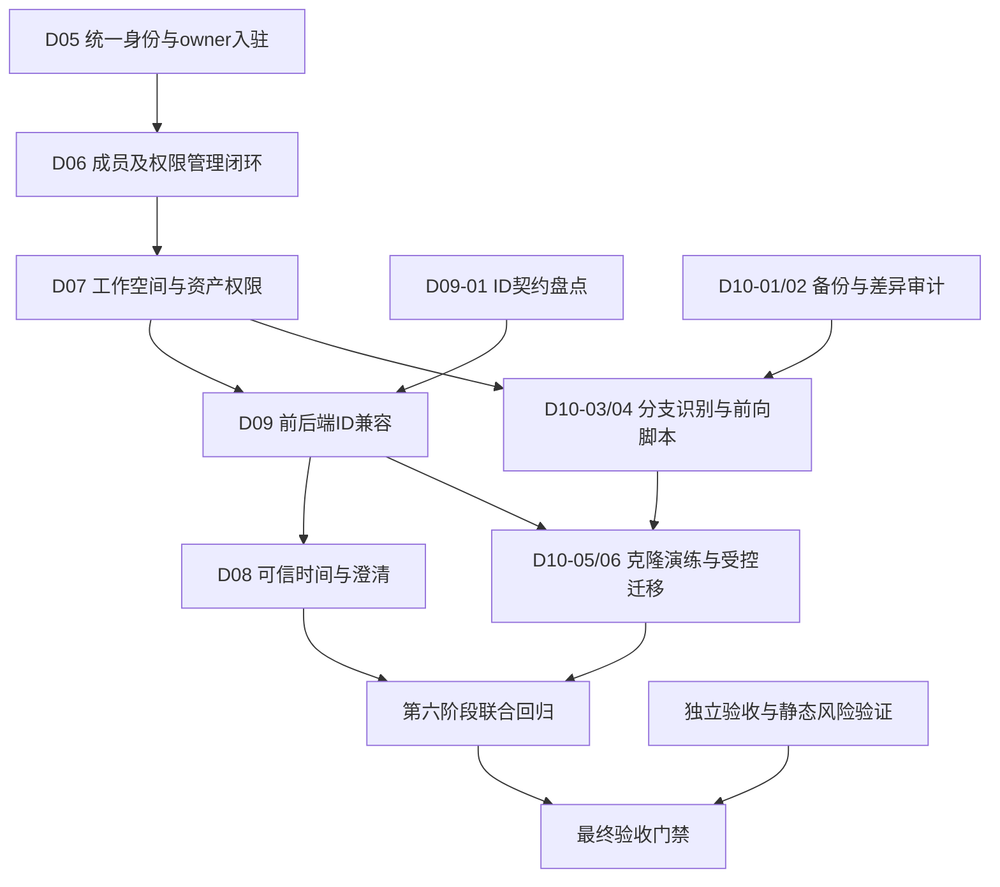

# 缺陷修复任务清单与实施计划

编制日期：2026-10-14（Asia/Shanghai）。范围：本轮仅代码、契约、迁移与历史测试证据审阅及计划生成；未执行业务修复、数据库迁移或新的系统回归。

项目根目录：`D:/1/Desktop/系统开发/AI BI 智能数据分析平台/ai-bi-platform`。代码基线为 `05ae2637a39f570bd685ab410b0eeacc70416c98` 加当前未提交内容。工作区原有大量修改和未跟踪源码，执行修复时不得 reset、覆盖或整仓误提交。

## 1. 缺陷处理总览表

| 缺陷 | 严重程度 | 当前缺陷状态 | 证据支持的异常/影响 | 修复任务 | 主阶段 |
|---|---|---|---|---|---|
| D01 | High | 已完成（历史已修复并回归） | 全局认证附旧租户头；现8个修复相关文件哈希与历史记录一致 | REG-D01只做持续验证，不重复计未修复 | 六 |
| D02 | Critical | 已完成（历史已修复并回归） | 默认生产内部密钥；新版本继续验证启动门禁 | REG-D02 | 六 |
| D03 | Medium | 已完成（历史已修复并回归） | 非ASCII HMAC造成500；保留拒绝校验 | REG-D03 | 六 |
| D04 | Medium | 已完成（历史已修复并回归） | naive/混合日期导致类型错误；保留AwareDatetime | REG-D04 | 六 |
| D05 | Critical | 待处理 | 匿名/跨租户读取、改名、冻结租户；身份和owner链缺失 | FIX-D05-01～04 | 一/P0 |
| D06 | Critical | 待处理 | 匿名添加成员后可切换进入目标租户 | FIX-D06-01～04 | 一/P0 |
| D07 | High | 待处理 | 无角色成员创建数据源成功；关联资产动作边界不完整 | FIX-D07-01～05 | 二/P1 |
| D09 | High | 待处理 | 64位ID被浏览器舍入，真实登录后404 | FIX-D09-01～05 | 三/P1 |
| D08 | High | 待处理 | 本月被解释为最近30天，影响指标口径 | FIX-D08-01～04 | 四/P1 |
| D10 | High | 待处理 | 旧MySQL缺13表，迁移历史与当前对象集合漂移 | FIX-D10-01～06 | 五/P1；备份审计P0先行 |

按根因仍是 **10项：4项已完成、6项待处理（2 Critical、4 High）**。28个FIX子任务只是拆分，不增加缺陷数。另列4个防回归、1个整体门禁、8个未完成验收、3个静态风险工作项；它们不自动转为已确认缺陷。

**证据分层。** 运行失败引用2026-10-13报告；当前代码阅读用于解释实现。静态发现的邀请范围未落地、权限管理入口、Token密钥和排队风险，未被本轮新运行证实。当前数据库未重新连接审计，13表与历史版本是上次快照，不宣称10月14日现场状态已复核。文件哈希一致只证明D01—D04相关源码未变，不能替代运行回归。全部新任务当前均为待处理；本计划写完不意味着修复已完成。

### 1.1 依据与冲突处理

| 来源（均位于项目根目录下） | 本轮采用范围 |
|---|---|
| `testing/reports/缺陷清单.md`、`11-系统最终上线验收报告.md`、01—10专项报告 | 根因编号、严重性、历史真实执行结果与未执行范围 |
| `testing/reports/evidence/live-api-results.json`、`live-browser-results.json`、`live-browser-failure.png` | D05—D07和D09动态失败；不同报告引用同一用例不重复计数 |
| `testing/reports/evidence/ai-business-acceptance.xml`、`database-details.json` | D08口径失败，D10缺表及版本快照 |
| `testing/reports/evidence/source-changes.json`与8个当前文件 | 本轮逐文件SHA-256比对全部一致 |
| `docs/AI BI 项目接口文档 V1.0.md`与`testing/reports/API覆盖矩阵.md` | 设计要求：身份→成员→工作空间→对象→权限，带时区/左闭右开；实际公共接口快照172条 |
| `docs/acceptance-multi-tenant-permissions.md`、`docs/acceptance-ai-intelligent-analysis.md` | 原设计DENY优先、RLS/CLS、任务重新鉴权、工具幂等；阶段“完成”不覆盖本次新增失败 |
| `backend/src/main/java/com/aibi/platform/`、`frontend/src/`、`ai-service/app/` | 控制器→服务→Mapper，协议/Pinia/SSE，LangGraph/schema/恢复链路 |
| `infrastructure/scripts/db.py`、`infrastructure/sql/mysql.sql`、`infrastructure/sql/mysql_migrations/` | 实际自定义迁移器、版本校验、DDL与业务对象依赖；并非假定使用Flyway |

设计文档部分路由仍写“待开发”，实际存在 `/api/tenants/{tenantId}` 等实现和 `/api/v1` 别名；文档称JWT，而当前TokenService使用自定义HMAC格式。修复以实际运行路由/协议为兼容对象，更新文档差异；不能按文档状态推断代码未实现或把别名当作独立版本。

### 1.2 工作量与责任

28个FIX任务合计初估 **36—60人日**（开发及任务级测试，非日历工期）。不含人工200题标注、环境准备、全量压测与故障演练，也不含审计后才发现的数据重建复杂度。每项可独立分支/提交，合并按依赖；功能关闭需完成其全部子任务并附证据。技术负责人统筹鉴权/契约，Java负责服务，前端负责状态和交互，AI负责时间状态机，DBA负责备份/迁移，QA独立验收。实际负责人待分派。

## 2. 缺陷修复任务明细表

每个任务下的文件链接指向已检查的实现或应继续展开的目录；新增组件/测试/迁移名称在实现时确定，不将计划文件假称为已存在。任务卡含根因、步骤、依赖、验收和回滚；复用第六、七节的公共门禁，不能因某卡未重复写出而省略。

### FIX-D05-01 建立身份、租户及动作鉴权入口

| 字段 | 任务要求 |
|---|---|
| 任务编号 | FIX-D05-01 |
| 关联缺陷 | D05 |
| 严重程度 | Critical |
| 所属模块 | Spring Boot / Vue3 / MySQL |
| 根因说明（证据边界） | TenantController 的创建、读取、修改及冻结入口未接收认证信息；TenantContextInterceptor 在缺少 X-Tenant-Id 时直接放行。TenantServiceImpl.createTenant 只写租户，未绑定首任所有者；冻结未递增权限版本。 依据：缺陷清单；evidence/live-api-results.json 的 4 条租户读写安全失败；TenantController、TenantServiceImpl、PermissionContextService。 |
| 具体问题 | 缺少租户头可避开统一上下文拦截；tenantId 路径参数并不证明调用人有权。 |
| 修复目标 | 公开端点使用明确白名单；受保护服务在任何入口均验证会话、成员、目标租户及动作。 |
| 涉及文件 | [backend/src/main/java/com/aibi/platform/identity/service/PermissionContextService.java](<D:/1/Desktop/系统开发/AI BI 智能数据分析平台/ai-bi-platform/backend/src/main/java/com/aibi/platform/identity/service/PermissionContextService.java>)<br>[backend/src/main/java/com/aibi/platform/identity/security/TenantContextInterceptor.java](<D:/1/Desktop/系统开发/AI BI 智能数据分析平台/ai-bi-platform/backend/src/main/java/com/aibi/platform/identity/security/TenantContextInterceptor.java>)<br>[backend/src/main/java/com/aibi/platform/config/ApiRoutingConfiguration.java](<D:/1/Desktop/系统开发/AI BI 智能数据分析平台/ai-bi-platform/backend/src/main/java/com/aibi/platform/config/ApiRoutingConfiguration.java>)<br>[backend/src/main/java/com/aibi/platform/identity/service/AccessDecisionService.java](<D:/1/Desktop/系统开发/AI BI 智能数据分析平台/ai-bi-platform/backend/src/main/java/com/aibi/platform/identity/service/AccessDecisionService.java>) |
| 子任务清单 | 1. 列出实际 /api 与 /api/v1 别名及内部入口，映射 global、tenant、platform 身份类型<br>2. 提取无循环依赖的统一鉴权组件，绑定服务层调用人而非信任请求 DTO<br>3. 定义 401/403/404、owner 与 tenant:manage/member:manage 规则并更新契约 |
| 实现方案 | 拦截器只做统一预检，关键服务必须调用 requireContext/动作决策；路径、头与令牌租户必须一致。owner 管理能力来自数据库有效成员，不接受客户端 owner/role。新建企业仅需有效全局会话，不能要求尚不存在的租户令牌。 |
| 前置依赖 | 无；可先行准备。实库写入仍须备份、环境与授权门禁。 |
| 风险和回滚 | 认证规则变更先部署兼容客户端与隔离夹具；保存权限配置快照。回滚保留默认拒绝，不能退回匿名白名单；新增组件避免与 AccessDecisionService/WorkspaceService 相互注入。 |
| 测试要求 | 单元：缺头、伪造头、无效/过期/撤销 token；接口：路径与令牌不一致、两套路径别名、服务层直调。 |
| 验收标准 | 所有受保护入口都进入统一鉴权；匿名 401、越权 403 或约定隐藏对象的 404；拒绝请求零业务写入。 |
| 预计工作量 | 1—1.5人日；复杂度估算，含任务级测试 |
| 执行优先级 | P0；第1阶段 |
| 当前状态 | 待处理（计划已编制，修复未开始） |

### FIX-D05-02 原子创建企业并绑定首任所有者

| 字段 | 任务要求 |
|---|---|
| 任务编号 | FIX-D05-02 |
| 关联缺陷 | D05 |
| 严重程度 | Critical |
| 所属模块 | Spring Boot / Vue3 / MySQL |
| 根因说明（证据边界） | TenantController 的创建、读取、修改及冻结入口未接收认证信息；TenantContextInterceptor 在缺少 X-Tenant-Id 时直接放行。TenantServiceImpl.createTenant 只写租户，未绑定首任所有者；冻结未递增权限版本。 依据：缺陷清单；evidence/live-api-results.json 的 4 条租户读写安全失败；TenantController、TenantServiceImpl、PermissionContextService。 |
| 具体问题 | 创建租户只插入租户记录；现有测试依靠另一个匿名接口补成员，无法建立可靠 owner 链。 |
| 修复目标 | 已登录用户入驻时，在同一事务内生成租户和首任 active owner；失败无半成品。 |
| 涉及文件 | [backend/src/main/java/com/aibi/platform/controller/TenantController.java](<D:/1/Desktop/系统开发/AI BI 智能数据分析平台/ai-bi-platform/backend/src/main/java/com/aibi/platform/controller/TenantController.java>)<br>[backend/src/main/java/com/aibi/platform/service/TenantService.java](<D:/1/Desktop/系统开发/AI BI 智能数据分析平台/ai-bi-platform/backend/src/main/java/com/aibi/platform/service/TenantService.java>)<br>[backend/src/main/java/com/aibi/platform/service/impl/TenantServiceImpl.java](<D:/1/Desktop/系统开发/AI BI 智能数据分析平台/ai-bi-platform/backend/src/main/java/com/aibi/platform/service/impl/TenantServiceImpl.java>)<br>[backend/src/main/java/com/aibi/platform/identity/service/MembershipService.java](<D:/1/Desktop/系统开发/AI BI 智能数据分析平台/ai-bi-platform/backend/src/main/java/com/aibi/platform/identity/service/MembershipService.java>)<br>[backend/src/main/java/com/aibi/platform/identity/mapper/MemberMapper.java](<D:/1/Desktop/系统开发/AI BI 智能数据分析平台/ai-bi-platform/backend/src/main/java/com/aibi/platform/identity/mapper/MemberMapper.java>)<br>[backend/src/main/java/com/aibi/platform/identity/mapper/JdbcMemberMapper.java](<D:/1/Desktop/系统开发/AI BI 智能数据分析平台/ai-bi-platform/backend/src/main/java/com/aibi/platform/identity/mapper/JdbcMemberMapper.java>)<br>[infrastructure/sql/mysql.sql](<D:/1/Desktop/系统开发/AI BI 智能数据分析平台/ai-bi-platform/infrastructure/sql/mysql.sql>) |
| 子任务清单 | 1. 由服务端会话获取 userId，忽略或拒绝外部所有者字段<br>2. 增加入驻编排及事务内成员插入，初始化最小管理权限；已有角色字典由迁移同步准备<br>3. 增加幂等键/重复 tenant_code 与失败重试处理；替换匿名测试夹具<br>4. 审计存量零所有者/异常所有者租户，输出逐租户修复清单 |
| 实现方案 | 复用 sys_tenant_member.is_owner 及 tenant/user 唯一约束；tenant、owner、必要管理绑定同一 MySQL 事务。存量归属必须用可信业务记录确认，不自动把第一个成员设为 owner；未知归属关闭管理写入并列待核实。 |
| 前置依赖 | FIX-D05-01 |
| 风险和回滚 | 实施前备份 tenant/member/角色绑定及关系；不删除已有租户。失败回滚事务；成功后的错误归属通过审计修正与权限版本递增处理。新建默认工作空间若非必要不扩大本任务。 |
| 测试要求 | 真实 MySQL 事务失败注入、重复/并发入驻、用户停用、匿名创建、存量归属审计。 |
| 验收标准 | 并发同幂等键只产生一个租户和一个首任 owner；插入成员失败时新增租户数=0；无匿名创建；所有存量异常归属有处理或阻断记录。 |
| 预计工作量 | 1.5—2.5人日；复杂度估算，含任务级测试 |
| 执行优先级 | P0；第1阶段 |
| 当前状态 | 待处理（计划已编制，修复未开始） |

### FIX-D05-03 保护租户读取修改并调整登录入驻流程

| 字段 | 任务要求 |
|---|---|
| 任务编号 | FIX-D05-03 |
| 关联缺陷 | D05 |
| 严重程度 | Critical |
| 所属模块 | Spring Boot / Vue3 / MySQL |
| 根因说明（证据边界） | TenantController 的创建、读取、修改及冻结入口未接收认证信息；TenantContextInterceptor 在缺少 X-Tenant-Id 时直接放行。TenantServiceImpl.createTenant 只写租户，未绑定首任所有者；冻结未递增权限版本。 依据：缺陷清单；evidence/live-api-results.json 的 4 条租户读写安全失败；TenantController、TenantServiceImpl、PermissionContextService。 |
| 具体问题 | 租户 GET/PUT 未鉴权；前端 tenant() 使用 auth:none，保护接口后现有登录顺序可能中断。 |
| 修复目标 | 普通有效成员可读本租户；owner/具有 tenant:manage 的有效成员可修改；跨租户拒绝。 |
| 涉及文件 | [backend/src/main/java/com/aibi/platform/controller/TenantController.java](<D:/1/Desktop/系统开发/AI BI 智能数据分析平台/ai-bi-platform/backend/src/main/java/com/aibi/platform/controller/TenantController.java>)<br>[backend/src/main/java/com/aibi/platform/service/impl/TenantServiceImpl.java](<D:/1/Desktop/系统开发/AI BI 智能数据分析平台/ai-bi-platform/backend/src/main/java/com/aibi/platform/service/impl/TenantServiceImpl.java>)<br>[frontend/src/auth/api.ts](<D:/1/Desktop/系统开发/AI BI 智能数据分析平台/ai-bi-platform/frontend/src/auth/api.ts>)<br>[frontend/src/stores/app.ts](<D:/1/Desktop/系统开发/AI BI 智能数据分析平台/ai-bi-platform/frontend/src/stores/app.ts>)<br>[frontend/src/api/client.ts](<D:/1/Desktop/系统开发/AI BI 智能数据分析平台/ai-bi-platform/frontend/src/api/client.ts>)<br>[testing/scripts/live_api_acceptance.py](<D:/1/Desktop/系统开发/AI BI 智能数据分析平台/ai-bi-platform/testing/scripts/live_api_acceptance.py>) |
| 子任务清单 | 1. 服务层检查目标与调用人租户，保留乐观锁<br>2. 前端先用全局会话获取自己的 memberships 并 switchTenant，再用租户 token 获取详情<br>3. 入驻使用 D05-02；全球会话请求保留 D01 不携带旧租户头规则<br>4. 测试夹具改用合法入驻/邀请，删除对匿名成功的业务假设 |
| 实现方案 | 如界面切换前需企业名称，在认证后的 membership 列表返回仅本人可见摘要；不恢复匿名详情接口。列举接口不得返回其他租户对象或可枚举存在性信息。 |
| 前置依赖 | FIX-D05-01、FIX-D05-02 |
| 风险和回滚 | 前后端顺序共同发布；旧客户端会失败应提示升级/重登。回退使用已鉴权兼容界面，不能撤销服务端保护。基础 API 回归阶段一可用精确整数客户端，完整大 ID 浏览器验证等 D09。 |
| 测试要求 | 真实 HTTP 原 D05 的 4 条失败场景；Playwright 合法登录、入驻、切换、刷新、退出；两租户相同业务编码。 |
| 验收标准 | 原 4 条安全失败全部转为正确拒绝；合法成员读取及授权修改成功；无跨租户写入，乐观锁冲突保持约定响应。 |
| 预计工作量 | 1—2人日；复杂度估算，含任务级测试 |
| 执行优先级 | P0；第1阶段 |
| 当前状态 | 待处理（计划已编制，修复未开始） |

### FIX-D05-04 冻结解冻与旧权限上下文失效

| 字段 | 任务要求 |
|---|---|
| 任务编号 | FIX-D05-04 |
| 关联缺陷 | D05 |
| 严重程度 | Critical |
| 所属模块 | Spring Boot / Vue3 / MySQL |
| 根因说明（证据边界） | TenantController 的创建、读取、修改及冻结入口未接收认证信息；TenantContextInterceptor 在缺少 X-Tenant-Id 时直接放行。TenantServiceImpl.createTenant 只写租户，未绑定首任所有者；冻结未递增权限版本。 依据：缺陷清单；evidence/live-api-results.json 的 4 条租户读写安全失败；TenantController、TenantServiceImpl、PermissionContextService。 |
| 具体问题 | requireCurrentContext 要求租户 ACTIVE；如果解冻也完全使用普通租户 token，将无法恢复。冻结未提高 permissionVersion 还可能使旧上下文在解冻后重新有效。 |
| 修复目标 | 冻结立即阻止新请求和异步结果；只有可信 owner 可通过窄范围恢复流程解冻，解冻后重新签发租户上下文。 |
| 涉及文件 | [backend/src/main/java/com/aibi/platform/service/impl/TenantServiceImpl.java](<D:/1/Desktop/系统开发/AI BI 智能数据分析平台/ai-bi-platform/backend/src/main/java/com/aibi/platform/service/impl/TenantServiceImpl.java>)<br>[backend/src/main/java/com/aibi/platform/manager/TenantManager.java](<D:/1/Desktop/系统开发/AI BI 智能数据分析平台/ai-bi-platform/backend/src/main/java/com/aibi/platform/manager/TenantManager.java>)<br>[backend/src/main/java/com/aibi/platform/mapper/JdbcTenantMapper.java](<D:/1/Desktop/系统开发/AI BI 智能数据分析平台/ai-bi-platform/backend/src/main/java/com/aibi/platform/mapper/JdbcTenantMapper.java>)<br>[backend/src/main/java/com/aibi/platform/identity/service/PermissionContextService.java](<D:/1/Desktop/系统开发/AI BI 智能数据分析平台/ai-bi-platform/backend/src/main/java/com/aibi/platform/identity/service/PermissionContextService.java>)<br>[backend/src/main/java/com/aibi/platform/identity/service/TaskAuthorizationService.java](<D:/1/Desktop/系统开发/AI BI 智能数据分析平台/ai-bi-platform/backend/src/main/java/com/aibi/platform/identity/service/TaskAuthorizationService.java>)<br>[frontend/src/auth/api.ts](<D:/1/Desktop/系统开发/AI BI 智能数据分析平台/ai-bi-platform/frontend/src/auth/api.ts>) |
| 子任务清单 | 1. 明确普通租户冻结权限与 owner 解冻例外<br>2. 新增或调整解冻路径为全局有效会话加数据库 owner 验证，仅该操作允许目标 FROZEN<br>3. 冻结/解冻事务更新状态、lockVersion 与 permissionVersion，记录审计<br>4. 覆盖执行中任务、旧 token、并发状态切换与重放 |
| 实现方案 | 不放宽通用 requireCurrentContext 的 ACTIVE 校验。平台运维解冻如已存在则独立凭证、权限和审计；未证实存在时不临时开放通用 admin 开关。版本单调递增，不因回滚还原。 |
| 前置依赖 | FIX-D05-01、FIX-D05-03 |
| 风险和回滚 | 保留经审核的恢复入口和状态快照；发现异常保持冻结并通过相同受控流程修复。不得将权限版本回退以恢复旧 token。 |
| 测试要求 | 冻结前后 query/AI/download/sync 结果交付、跨租户 owner、停用 owner、过期 global token、重复冻结/解冻、乐观并发。 |
| 验收标准 | 冻结后所有新租户操作和未交付敏感结果拒绝；授权 owner 可解冻；解冻后旧 tenant token 仍不可用，新上下文可正常使用。 |
| 预计工作量 | 1—1.5人日；复杂度估算，含任务级测试 |
| 执行优先级 | P0；第1阶段 |
| 当前状态 | 待处理（计划已编制，修复未开始） |

### FIX-D06-01 关闭匿名加成员并限制管理者添加

| 字段 | 任务要求 |
|---|---|
| 任务编号 | FIX-D06-01 |
| 关联缺陷 | D06 |
| 严重程度 | Critical |
| 所属模块 | Spring Boot / MySQL / Vue3 |
| 根因说明（证据边界） | MemberController.addMember 与 MembershipService.addMember 无调用人鉴权，只校验租户和目标用户状态；有效成员即可由 PermissionContextService.switchTenant 获得上下文。相邻成员/邀请/角色管理服务存在只验证上下文的静态边界缺口，尚未逐入口运行复现。 依据：evidence/live-api-results.json：SEC_anonymous_member_add=201，之后 switch_tenant_global=200；对应控制器和服务源码。 |
| 具体问题 | 已知用户可被匿名加入目标租户，继而合法执行 switchTenant。 |
| 修复目标 | 仅 owner 或具备 member:manage 的当前租户管理者能添加目标成员；本人加入走受控邀请。 |
| 涉及文件 | [backend/src/main/java/com/aibi/platform/identity/controller/MemberController.java](<D:/1/Desktop/系统开发/AI BI 智能数据分析平台/ai-bi-platform/backend/src/main/java/com/aibi/platform/identity/controller/MemberController.java>)<br>[backend/src/main/java/com/aibi/platform/identity/service/MembershipService.java](<D:/1/Desktop/系统开发/AI BI 智能数据分析平台/ai-bi-platform/backend/src/main/java/com/aibi/platform/identity/service/MembershipService.java>)<br>[backend/src/main/java/com/aibi/platform/identity/service/PermissionContextService.java](<D:/1/Desktop/系统开发/AI BI 智能数据分析平台/ai-bi-platform/backend/src/main/java/com/aibi/platform/identity/service/PermissionContextService.java>) |
| 子任务清单 | 1. 为 addMember 增加认证上下文及动作校验<br>2. 校验目标用户状态、租户状态、重复成员、不可由请求设置 owner<br>3. 保持 switchTenant 必须检查当前 active membership，不以头部或旧快照放行<br>4. 增加匿名攻击完整链路回归 |
| 实现方案 | 认证和动作检查先于成员插入；创建首任 owner 只允许 D05-02 内部事务调用。普通添加接口不可承担匿名初始化。 |
| 前置依赖 | FIX-D05-01、FIX-D05-02 |
| 风险和回滚 | 先盘点现有集成和测试夹具。受疑历史成员单独核查授权来源，不批量删除；可审计停用及递增版本。回滚保留关闭匿名的控制。 |
| 测试要求 | SEC_anonymous_member_add→switch_tenant 全链路；普通/无角色成员、跨租户管理员、停用用户、幂等重试。 |
| 验收标准 | 匿名 add 返回401且成员增量0；攻击用户 switchTenant 失败；授权添加201且只添加一个非 owner 成员。 |
| 预计工作量 | 0.5—1人日；复杂度估算，含任务级测试 |
| 执行优先级 | P0；第1阶段 |
| 当前状态 | 待处理（计划已编制，修复未开始） |

### FIX-D06-02 成员生命周期与最后所有者约束

| 字段 | 任务要求 |
|---|---|
| 任务编号 | FIX-D06-02 |
| 关联缺陷 | D06 |
| 严重程度 | Critical |
| 所属模块 | Spring Boot / MySQL / Vue3 |
| 根因说明（证据边界） | MemberController.addMember 与 MembershipService.addMember 无调用人鉴权，只校验租户和目标用户状态；有效成员即可由 PermissionContextService.switchTenant 获得上下文。相邻成员/邀请/角色管理服务存在只验证上下文的静态边界缺口，尚未逐入口运行复现。 依据：evidence/live-api-results.json：SEC_anonymous_member_add=201，之后 switch_tenant_global=200；对应控制器和服务源码。 |
| 具体问题 | 停用/移除已校验上下文并保护 owner，但缺 member:manage；并发变更和存量 owner 修复需要明确事务不变量。 |
| 修复目标 | 所有成员状态变更鉴权；正常租户始终至少保留一位有效 owner；撤权立即失效。 |
| 涉及文件 | [backend/src/main/java/com/aibi/platform/identity/service/MembershipService.java](<D:/1/Desktop/系统开发/AI BI 智能数据分析平台/ai-bi-platform/backend/src/main/java/com/aibi/platform/identity/service/MembershipService.java>)<br>[backend/src/main/java/com/aibi/platform/identity/mapper/MemberMapper.java](<D:/1/Desktop/系统开发/AI BI 智能数据分析平台/ai-bi-platform/backend/src/main/java/com/aibi/platform/identity/mapper/MemberMapper.java>)<br>[backend/src/main/java/com/aibi/platform/identity/mapper/JdbcMemberMapper.java](<D:/1/Desktop/系统开发/AI BI 智能数据分析平台/ai-bi-platform/backend/src/main/java/com/aibi/platform/identity/mapper/JdbcMemberMapper.java>)<br>[backend/src/main/java/com/aibi/platform/identity/mapper/InMemoryMemberMapper.java](<D:/1/Desktop/系统开发/AI BI 智能数据分析平台/ai-bi-platform/backend/src/main/java/com/aibi/platform/identity/mapper/InMemoryMemberMapper.java>)<br>[backend/src/main/java/com/aibi/platform/identity/service/MemberRoleService.java](<D:/1/Desktop/系统开发/AI BI 智能数据分析平台/ai-bi-platform/backend/src/main/java/com/aibi/platform/identity/service/MemberRoleService.java>) |
| 子任务清单 | 1. 停用、移除和角色撤销增加明确动作权限及目标归属<br>2. 以租户锁或等效数据库锁保护最后 owner；审计现有 owner 字段更新路径<br>3. 如业务已有转移所有者操作，原子转移并防自提权；没有则不新增随意转移入口<br>4. 同步 JDBC 与内存实现、更新相关权限版本 |
| 实现方案 | 所有者转移只用独立受控服务，禁止通用 member DTO 修改 is_owner。现 JdbcMemberMapper.update 不更新 owner，需专门受控操作；任何 owner 修复均有来源记录。 |
| 前置依赖 | FIX-D06-01 |
| 风险和回滚 | 备份成员和授权关系；采用事务补偿，不恢复已失效权限版本。历史零 owner 租户由 D05-02 清单处理，不能通过放开匿名修复。 |
| 测试要求 | 最后 owner 并发停用/移除、普通成员改 owner、A 租户管理 B、在途查询撤权。 |
| 验收标准 | 越权操作0成功；并发操作后有效 owner 数不小于1；移除或停用后旧 token 和任务结果访问均失败。 |
| 预计工作量 | 1—1.5人日；复杂度估算，含任务级测试 |
| 执行优先级 | P0；第1阶段 |
| 当前状态 | 待处理（计划已编制，修复未开始） |

### FIX-D06-03 邀请创建、接受及授权范围闭环

| 字段 | 任务要求 |
|---|---|
| 任务编号 | FIX-D06-03 |
| 关联缺陷 | D06 |
| 严重程度 | Critical |
| 所属模块 | Spring Boot / MySQL / Vue3 |
| 根因说明（证据边界） | MemberController.addMember 与 MembershipService.addMember 无调用人鉴权，只校验租户和目标用户状态；有效成员即可由 PermissionContextService.switchTenant 获得上下文。相邻成员/邀请/角色管理服务存在只验证上下文的静态边界缺口，尚未逐入口运行复现。 依据：evidence/live-api-results.json：SEC_anonymous_member_add=201，之后 switch_tenant_global=200；对应控制器和服务源码。 |
| 具体问题 | 邀请创建仅检查租户上下文；请求持久化 roleId/workspaceId，但接受邀请当前只建成员，未兑现该范围绑定。 |
| 修复目标 | 邀请必须由有权管理者发起；接受时核实本人邮箱、邀请状态和当前可委派范围，原子加入且不扩大权限。 |
| 涉及文件 | [backend/src/main/java/com/aibi/platform/identity/service/InvitationService.java](<D:/1/Desktop/系统开发/AI BI 智能数据分析平台/ai-bi-platform/backend/src/main/java/com/aibi/platform/identity/service/InvitationService.java>)<br>[backend/src/main/java/com/aibi/platform/identity/controller/InvitationController.java](<D:/1/Desktop/系统开发/AI BI 智能数据分析平台/ai-bi-platform/backend/src/main/java/com/aibi/platform/identity/controller/InvitationController.java>)<br>[backend/src/main/java/com/aibi/platform/identity/controller/InvitationAcceptanceController.java](<D:/1/Desktop/系统开发/AI BI 智能数据分析平台/ai-bi-platform/backend/src/main/java/com/aibi/platform/identity/controller/InvitationAcceptanceController.java>)<br>[backend/src/main/java/com/aibi/platform/identity/mapper/JdbcInvitationMapper.java](<D:/1/Desktop/系统开发/AI BI 智能数据分析平台/ai-bi-platform/backend/src/main/java/com/aibi/platform/identity/mapper/JdbcInvitationMapper.java>)<br>[backend/src/main/java/com/aibi/platform/identity/service/WorkspaceService.java](<D:/1/Desktop/系统开发/AI BI 智能数据分析平台/ai-bi-platform/backend/src/main/java/com/aibi/platform/identity/service/WorkspaceService.java>)<br>[backend/src/main/java/com/aibi/platform/identity/service/MemberRoleService.java](<D:/1/Desktop/系统开发/AI BI 智能数据分析平台/ai-bi-platform/backend/src/main/java/com/aibi/platform/identity/service/MemberRoleService.java>) |
| 子任务清单 | 1. 补邀请管理动作权限，校验角色/工作空间属于同租户<br>2. 确定邀请时授权快照与接受时复核规则，撤权邀请不得继续扩权<br>3. 在接受事务中按明确契约建立 member/workspace/role 关系并原子消费邀请<br>4. 处理过期、并发接受、已成员、角色删除及授权回收 |
| 实现方案 | 沿用全局认证与邮箱匹配，邀请 token 哈希存储。默认禁止委派高于邀请者当前可授予范围的权限；owner 不能通过普通邀请设置。空 role 进入无角色默认拒绝状态。 |
| 前置依赖 | FIX-D06-01、FIX-D06-02 |
| 风险和回滚 | 现有未消费邀请需要重核范围或作废后重发；保留哈希审计，不记录明文 token。事务失败不消费邀请、不留下部分授权。 |
| 测试要求 | 邮箱不匹配、跨租户 role/workspace、过期重放、双并发接受、发起人被撤权、空角色加入。 |
| 验收标准 | 同邀请最多一次有效加入；角色/工作空间绑定与契约一致；任意子步骤失败净新增关系0；无法通过邀请获得 owner。 |
| 预计工作量 | 1—2人日；复杂度估算，含任务级测试 |
| 执行优先级 | P0；第1阶段 |
| 当前状态 | 待处理（计划已编制，修复未开始） |

### FIX-D06-04 封闭角色、ACL 和策略管理提权通路

| 字段 | 任务要求 |
|---|---|
| 任务编号 | FIX-D06-04 |
| 关联缺陷 | D06 |
| 严重程度 | Critical |
| 所属模块 | Spring Boot / MySQL / Vue3 |
| 根因说明（证据边界） | MemberController.addMember 与 MembershipService.addMember 无调用人鉴权，只校验租户和目标用户状态；有效成员即可由 PermissionContextService.switchTenant 获得上下文。相邻成员/邀请/角色管理服务存在只验证上下文的静态边界缺口，尚未逐入口运行复现。 依据：evidence/live-api-results.json：SEC_anonymous_member_add=201，之后 switch_tenant_global=200；对应控制器和服务源码。 |
| 具体问题 | 静态阅读显示部分写入口只验证成员上下文；若可自行授予 role 或 ACL，D07 数据源权限会被绕过。此范围为 D06 关联加固，尚非新增已复现缺陷。 |
| 修复目标 | 所有权限写入都需要对应管理动作，不能创建系统权限码或自授更高能力。 |
| 涉及文件 | [backend/src/main/java/com/aibi/platform/identity/service/RolePermissionService.java](<D:/1/Desktop/系统开发/AI BI 智能数据分析平台/ai-bi-platform/backend/src/main/java/com/aibi/platform/identity/service/RolePermissionService.java>)<br>[backend/src/main/java/com/aibi/platform/identity/service/MemberRoleService.java](<D:/1/Desktop/系统开发/AI BI 智能数据分析平台/ai-bi-platform/backend/src/main/java/com/aibi/platform/identity/service/MemberRoleService.java>)<br>[backend/src/main/java/com/aibi/platform/identity/service/WorkspaceService.java](<D:/1/Desktop/系统开发/AI BI 智能数据分析平台/ai-bi-platform/backend/src/main/java/com/aibi/platform/identity/service/WorkspaceService.java>)<br>[backend/src/main/java/com/aibi/platform/identity/service/AccessDecisionService.java](<D:/1/Desktop/系统开发/AI BI 智能数据分析平台/ai-bi-platform/backend/src/main/java/com/aibi/platform/identity/service/AccessDecisionService.java>)<br>[backend/src/main/java/com/aibi/platform/identity/service/DataPolicyService.java](<D:/1/Desktop/系统开发/AI BI 智能数据分析平台/ai-bi-platform/backend/src/main/java/com/aibi/platform/identity/service/DataPolicyService.java>)<br>[backend/src/main/java/com/aibi/platform/identity/service/DepartmentService.java](<D:/1/Desktop/系统开发/AI BI 智能数据分析平台/ai-bi-platform/backend/src/main/java/com/aibi/platform/identity/service/DepartmentService.java>) |
| 子任务清单 | 1. 逐控制器到服务列出角色、成员角色、工作空间成员、部门、ACL、RLS/CLS 的写入口<br>2. 权限字典写入改为受控平台/部署路径；租户角色修改要求 role:manage<br>3. workspace:manage、policy:manage、asset ACL manage 按对象归属与可委派范围验证<br>4. 保护系统/owner 权限并统一增加版本和审计；为每条写路由新增负向测试 |
| 实现方案 | 复用 D05-01 的统一判断，权限字典由受控迁移提供，不让任意全局登录用户定义高权限码。ACL/策略管理权限不能从待修改的那条 ACL 自行推导；保留显式 DENY 优先语义。 |
| 前置依赖 | FIX-D05-01、FIX-D06-02 |
| 风险和回滚 | 上线前导出角色/ACL/策略映射，默认不赋全员管理员；收紧后显式修复合法授权。配置回滚只能收敛或恢复审核配置，禁止关闭鉴权。 |
| 测试要求 | 无角色自授 role、修改系统权限码、ACL 自授、策略降级、部门绕过、跨租户对象绑定、正常管理者授权及撤权。 |
| 验收标准 | 入口清单100%覆盖；所有自提权链路失败且无写入；合法授权成功并使旧上下文失效；DENY 优先测试不退化。 |
| 预计工作量 | 1.5—2.5人日；复杂度估算，含任务级测试 |
| 执行优先级 | P0；第1阶段 |
| 当前状态 | 待处理（计划已编制，修复未开始） |

### FIX-D07-01 定义动作权限与工作空间资产统一模型

| 字段 | 任务要求 |
|---|---|
| 任务编号 | FIX-D07-01 |
| 关联缺陷 | D07 |
| 严重程度 | High |
| 所属模块 | Spring Boot / Vue3 / MySQL / 异步同步与导入 |
| 根因说明（证据边界） | DatasourceServiceImpl 未调用动作权限或资产授权服务，创建时未核实工作空间授权。现有 AccessDecisionService 有 RBAC、工作空间成员、ACL 与 DENY 优先能力，但数据源、文件和同步链路未统一接入；文件实体/Mapper 未承载已有 workspace_id、owner_member_id。 依据：evidence/live-api-results.json：SEC_roleless_datasource_create=201；DatasourceServiceImpl、FileEntity、JdbcIngestionMapper、SyncController 静态阅读。 |
| 具体问题 | 已有权限字典和 ACL 可复用，但数据源/文件/同步动作不完整，内存和 MySQL 权限码种子不一致；仅资源 owner 回退可能让无角色成员获得动作。 |
| 修复目标 | 所有目标动作必须同时满足角色能力、有效工作空间成员和对象范围；显式 DENY 优先、默认拒绝。 |
| 涉及文件 | [backend/src/main/java/com/aibi/platform/identity/service/AccessDecisionService.java](<D:/1/Desktop/系统开发/AI BI 智能数据分析平台/ai-bi-platform/backend/src/main/java/com/aibi/platform/identity/service/AccessDecisionService.java>)<br>[backend/src/main/java/com/aibi/platform/identity/mapper/InMemoryAccessControlMapper.java](<D:/1/Desktop/系统开发/AI BI 智能数据分析平台/ai-bi-platform/backend/src/main/java/com/aibi/platform/identity/mapper/InMemoryAccessControlMapper.java>)<br>[backend/src/main/java/com/aibi/platform/identity/mapper/JdbcAssetAccessMapper.java](<D:/1/Desktop/系统开发/AI BI 智能数据分析平台/ai-bi-platform/backend/src/main/java/com/aibi/platform/identity/mapper/JdbcAssetAccessMapper.java>)<br>[backend/src/main/java/com/aibi/platform/identity/service/WorkspaceService.java](<D:/1/Desktop/系统开发/AI BI 智能数据分析平台/ai-bi-platform/backend/src/main/java/com/aibi/platform/identity/service/WorkspaceService.java>)<br>[infrastructure/sql/mysql.sql](<D:/1/Desktop/系统开发/AI BI 智能数据分析平台/ai-bi-platform/infrastructure/sql/mysql.sql>)<br>[infrastructure/sql/mysql_migrations/](<D:/1/Desktop/系统开发/AI BI 智能数据分析平台/ai-bi-platform/infrastructure/sql/mysql_migrations/>) |
| 子任务清单 | 1. 依据第六节矩阵定义 datasource/file/import/sync 动作及管理范围<br>2. 复用 sys_asset/sys_asset_acl 绑定真实资源，不允许虚构 asset_ref_id 获取访问<br>3. 统一内存及数据库权限种子；增量迁移归入 D10 兼容分支，不改历史 SQL<br>4. 设计存量未绑定资源审计及可信 owner/workspace 回填清单 |
| 实现方案 | 增加受控的动作能力判断后复用 ACL，角色能力与对象范围取交集；既有 owner fallback 不可绕过目标动作所需角色。租户 owner 的 IAM 管理能力与资源 owner 分开，资源 DENY 仍优先。 |
| 前置依赖 | FIX-D06-04 |
| 风险和回滚 | 新权限码和存量映射采用显式迁移，不默认全员 ALLOW；未知资源暂不可访问，提供管理修复清单。兼容已有 RLS/CLS 决策；必要结构只做前向增加。 |
| 测试要求 | 权限判定表驱动单元测试；JDBC/内存种子一致；资源/工作空间错配、角色 DENY、ACL DENY、无角色 owner。 |
| 验收标准 | 矩阵所有格子有测试；无角色无任何受保护业务动作；ACL ALLOW 不能覆盖角色或 ACL DENY；不存在跨租户资产绑定。 |
| 预计工作量 | 1—2人日；复杂度估算，含任务级测试 |
| 执行优先级 | P1；第2阶段 |
| 当前状态 | 待处理（计划已编制，修复未开始） |

### FIX-D07-02 数据源全生命周期动作鉴权

| 字段 | 任务要求 |
|---|---|
| 任务编号 | FIX-D07-02 |
| 关联缺陷 | D07 |
| 严重程度 | High |
| 所属模块 | Spring Boot / Vue3 / MySQL / 异步同步与导入 |
| 根因说明（证据边界） | DatasourceServiceImpl 未调用动作权限或资产授权服务，创建时未核实工作空间授权。现有 AccessDecisionService 有 RBAC、工作空间成员、ACL 与 DENY 优先能力，但数据源、文件和同步链路未统一接入；文件实体/Mapper 未承载已有 workspace_id、owner_member_id。 依据：evidence/live-api-results.json：SEC_roleless_datasource_create=201；DatasourceServiceImpl、FileEntity、JdbcIngestionMapper、SyncController 静态阅读。 |
| 具体问题 | 创建、列表、修改、连接测试和元数据入口缺统一动作限制；创建凭据可能先于授权持久化。 |
| 修复目标 | 创建须有工作空间 manage；读取/连接测试/修改/停用/删除各自按矩阵鉴权，列表不泄露不可见资源。 |
| 涉及文件 | [backend/src/main/java/com/aibi/platform/source/controller/DatasourceController.java](<D:/1/Desktop/系统开发/AI BI 智能数据分析平台/ai-bi-platform/backend/src/main/java/com/aibi/platform/source/controller/DatasourceController.java>)<br>[backend/src/main/java/com/aibi/platform/source/service/DatasourceServiceImpl.java](<D:/1/Desktop/系统开发/AI BI 智能数据分析平台/ai-bi-platform/backend/src/main/java/com/aibi/platform/source/service/DatasourceServiceImpl.java>)<br>[backend/src/main/java/com/aibi/platform/source/store/DatasourceStore.java](<D:/1/Desktop/系统开发/AI BI 智能数据分析平台/ai-bi-platform/backend/src/main/java/com/aibi/platform/source/store/DatasourceStore.java>)<br>[backend/src/main/java/com/aibi/platform/source/store/JdbcDatasourceStore.java](<D:/1/Desktop/系统开发/AI BI 智能数据分析平台/ai-bi-platform/backend/src/main/java/com/aibi/platform/source/store/JdbcDatasourceStore.java>)<br>[backend/src/main/java/com/aibi/platform/source/store/InMemoryDatasourceStore.java](<D:/1/Desktop/系统开发/AI BI 智能数据分析平台/ai-bi-platform/backend/src/main/java/com/aibi/platform/source/store/InMemoryDatasourceStore.java>)<br>[backend/src/main/java/com/aibi/platform/identity/service/AccessDecisionService.java](<D:/1/Desktop/系统开发/AI BI 智能数据分析平台/ai-bi-platform/backend/src/main/java/com/aibi/platform/identity/service/AccessDecisionService.java>) |
| 子任务清单 | 1. 为所有实际 datasource 路由映射动作并服务层执行<br>2. 鉴权和归属验证放在凭据写入、网络连接之前<br>3. 创建资源与资产登记保持事务一致，凭据外部存储失败做补偿<br>4. 列表按授权过滤且分页/总数保持一致；凭据引用与敏感错误脱敏 |
| 实现方案 | 保存型连接测试检查现有资产 test 权限；未保存连接测试检查目标 workspace 的 create/test 能力。metadata 与 dependency 查询也不得绕过读取权限；更新禁止把资源移到未授权工作空间。 |
| 前置依赖 | FIX-D07-01 |
| 风险和回滚 | 已有凭据引用不重建、不输出；回滚继续保留鉴权。补偿只能删除本次创建的孤立凭据，不影响其他资源引用。 |
| 测试要求 | 原 roleless201 复现；四角色+owner、跨 workspace、隐藏列表计数、无权连接测试零外呼、创建失败凭据补偿。 |
| 验收标准 | 无角色创建403；授权管理员创建201且资源与资产唯一对应；无权请求数据库/凭据/网络副作用均为0；敏感信息0泄露。 |
| 预计工作量 | 1.5—2.5人日；复杂度估算，含任务级测试 |
| 执行优先级 | P1；第2阶段 |
| 当前状态 | 待处理（计划已编制，修复未开始） |

### FIX-D07-03 文件上传、下载及导入资产范围

| 字段 | 任务要求 |
|---|---|
| 任务编号 | FIX-D07-03 |
| 关联缺陷 | D07 |
| 严重程度 | High |
| 所属模块 | Spring Boot / Vue3 / MySQL / 异步同步与导入 |
| 根因说明（证据边界） | DatasourceServiceImpl 未调用动作权限或资产授权服务，创建时未核实工作空间授权。现有 AccessDecisionService 有 RBAC、工作空间成员、ACL 与 DENY 优先能力，但数据源、文件和同步链路未统一接入；文件实体/Mapper 未承载已有 workspace_id、owner_member_id。 依据：evidence/live-api-results.json：SEC_roleless_datasource_create=201；DatasourceServiceImpl、FileEntity、JdbcIngestionMapper、SyncController 静态阅读。 |
| 具体问题 | 文件上传只接收 tenant/file；FileEntity 与 insert/select 未读写表中已有 workspace_id 和 owner_member_id，tenant 相同不能代表文件可访问。 |
| 修复目标 | 文件从上传到预览、内容下载、创建导入、查询状态均绑定可信 workspace/owner 和资产权限。 |
| 涉及文件 | [backend/src/main/java/com/aibi/platform/ingestion/controller/FileImportController.java](<D:/1/Desktop/系统开发/AI BI 智能数据分析平台/ai-bi-platform/backend/src/main/java/com/aibi/platform/ingestion/controller/FileImportController.java>)<br>[backend/src/main/java/com/aibi/platform/ingestion/entity/FileEntity.java](<D:/1/Desktop/系统开发/AI BI 智能数据分析平台/ai-bi-platform/backend/src/main/java/com/aibi/platform/ingestion/entity/FileEntity.java>)<br>[backend/src/main/java/com/aibi/platform/ingestion/mapper/JdbcIngestionMapper.java](<D:/1/Desktop/系统开发/AI BI 智能数据分析平台/ai-bi-platform/backend/src/main/java/com/aibi/platform/ingestion/mapper/JdbcIngestionMapper.java>)<br>[backend/src/main/java/com/aibi/platform/ingestion/mapper/InMemoryIngestionMapper.java](<D:/1/Desktop/系统开发/AI BI 智能数据分析平台/ai-bi-platform/backend/src/main/java/com/aibi/platform/ingestion/mapper/InMemoryIngestionMapper.java>)<br>[backend/src/main/java/com/aibi/platform/ingestion/service/IngestionServiceImpl.java](<D:/1/Desktop/系统开发/AI BI 智能数据分析平台/ai-bi-platform/backend/src/main/java/com/aibi/platform/ingestion/service/IngestionServiceImpl.java>)<br>[backend/src/main/java/com/aibi/platform/ingestion/manager/FileImportManager.java](<D:/1/Desktop/系统开发/AI BI 智能数据分析平台/ai-bi-platform/backend/src/main/java/com/aibi/platform/ingestion/manager/FileImportManager.java>)<br>[infrastructure/sql/mysql.sql](<D:/1/Desktop/系统开发/AI BI 智能数据分析平台/ai-bi-platform/infrastructure/sql/mysql.sql>) |
| 子任务清单 | 1. DTO/实体/Mapper 增加可信范围并完成双存储实现<br>2. 上传前校验工作空间 file:upload；预览/下载校验 file:read/download<br>3. 导入同时校验文件和目标 dataset/workspace，creator 取服务端成员<br>4. 存量空范围文件从可信 import/job 关系回填，冲突或孤儿隔离；限制直链与缓存交付 |
| 实现方案 | 利用现有列，先审计实库是否一致再决定迁移。旧客户端若没传 workspace，只有服务端可唯一确定且授权时兼容；歧义返回明确错误。文件存储写失败/DB失败清理本次孤立对象，不扩大读取范围。 |
| 前置依赖 | FIX-D07-01 |
| 风险和回滚 | 备份对象元数据和文件清单，保留实际文件；存量推断必须留证据。回滚不取消范围限制，提供兼容读层。下载缓存键含租户与授权上下文，结果交付前再校验。 |
| 测试要求 | 跨租户/跨workspace文件ID、无角色上传、分析师上传与导入、查看者默认禁原始下载、重复导入、事务/对象存储失败。 |
| 验收标准 | 所有文件接口拒绝越权；文件与目标数据集错配不得提交；回填前后文件数量与哈希不变；孤儿文件没有隐式公共权限。 |
| 预计工作量 | 2—3人日；复杂度估算，含任务级测试 |
| 执行优先级 | P1；第2阶段 |
| 当前状态 | 待处理（计划已编制，修复未开始） |

### FIX-D07-04 同步与导入异步任务持续鉴权

| 字段 | 任务要求 |
|---|---|
| 任务编号 | FIX-D07-04 |
| 关联缺陷 | D07 |
| 严重程度 | High |
| 所属模块 | Spring Boot / Vue3 / MySQL / 异步同步与导入 |
| 根因说明（证据边界） | DatasourceServiceImpl 未调用动作权限或资产授权服务，创建时未核实工作空间授权。现有 AccessDecisionService 有 RBAC、工作空间成员、ACL 与 DENY 优先能力，但数据源、文件和同步链路未统一接入；文件实体/Mapper 未承载已有 workspace_id、owner_member_id。 依据：evidence/live-api-results.json：SEC_roleless_datasource_create=201；DatasourceServiceImpl、FileEntity、JdbcIngestionMapper、SyncController 静态阅读。 |
| 具体问题 | 同步创建/执行/取消等只有租户头入口；异步 worker 需要避免启动鉴权后撤权仍写入、发布或返回结果。 |
| 修复目标 | 控制面与 worker 均检查动作、资源范围和当前权限，后台调度使用服务端可撤销的最小服务身份。 |
| 涉及文件 | [backend/src/main/java/com/aibi/platform/ingestion/controller/SyncController.java](<D:/1/Desktop/系统开发/AI BI 智能数据分析平台/ai-bi-platform/backend/src/main/java/com/aibi/platform/ingestion/controller/SyncController.java>)<br>[backend/src/main/java/com/aibi/platform/ingestion/service/IngestionServiceImpl.java](<D:/1/Desktop/系统开发/AI BI 智能数据分析平台/ai-bi-platform/backend/src/main/java/com/aibi/platform/ingestion/service/IngestionServiceImpl.java>)<br>[backend/src/main/java/com/aibi/platform/ingestion/manager/SyncWorkerManager.java](<D:/1/Desktop/系统开发/AI BI 智能数据分析平台/ai-bi-platform/backend/src/main/java/com/aibi/platform/ingestion/manager/SyncWorkerManager.java>)<br>[backend/src/main/java/com/aibi/platform/ingestion/manager/ImportWorkerManager.java](<D:/1/Desktop/系统开发/AI BI 智能数据分析平台/ai-bi-platform/backend/src/main/java/com/aibi/platform/ingestion/manager/ImportWorkerManager.java>)<br>[backend/src/main/java/com/aibi/platform/identity/service/TaskAuthorizationService.java](<D:/1/Desktop/系统开发/AI BI 智能数据分析平台/ai-bi-platform/backend/src/main/java/com/aibi/platform/identity/service/TaskAuthorizationService.java>)<br>[backend/src/main/java/com/aibi/platform/ingestion/dto/IngestionDtos.java](<D:/1/Desktop/系统开发/AI BI 智能数据分析平台/ai-bi-platform/backend/src/main/java/com/aibi/platform/ingestion/dto/IngestionDtos.java>) |
| 子任务清单 | 1. 映射 create/read/update/enable/pause/run/cancel/compensate 及导入动作<br>2. 复用 TaskAuthorizationService 捕获授权快照，执行前及发布/结果交付前重新校验<br>3. 区分用户发起任务和可信调度身份，客户端不可声明 service principal<br>4. 撤权后阻止继续读取/发布，妥善标记批次与恢复点，重试保持幂等 |
| 实现方案 | 源 datasource、目标 dataset、job/run 需同租户且授权范围一致。权限快照只提供追踪，不替代当前判断；已提交合法数据不能因撤权随意删除，未发布批次按状态机终止/隔离。 |
| 前置依赖 | FIX-D07-02、FIX-D07-03 |
| 风险和回滚 | 备份任务/批次/发布状态；新快照字段双读过渡，不信任缺快照的旧任务，暂停并重新授权。回滚保持暂停状态，不能直接以系统无限权限继续。 |
| 测试要求 | 排队中、执行中、发布前、结果读取前撤权；成员停用、租户冻结、重复事件、补偿重跑、用户与调度身份隔离。 |
| 验收标准 | 所有权限失效窗口均无新越权读取/发布/交付；重复任务无重复发布/金额；其他租户任务继续可用。 |
| 预计工作量 | 2—3人日；复杂度估算，含任务级测试 |
| 执行优先级 | P1；第2阶段 |
| 当前状态 | 待处理（计划已编制，修复未开始） |

### FIX-D07-05 前端权限交互及完整接口矩阵回归

| 字段 | 任务要求 |
|---|---|
| 任务编号 | FIX-D07-05 |
| 关联缺陷 | D07 |
| 严重程度 | High |
| 所属模块 | Spring Boot / Vue3 / MySQL / 异步同步与导入 |
| 根因说明（证据边界） | DatasourceServiceImpl 未调用动作权限或资产授权服务，创建时未核实工作空间授权。现有 AccessDecisionService 有 RBAC、工作空间成员、ACL 与 DENY 优先能力，但数据源、文件和同步链路未统一接入；文件实体/Mapper 未承载已有 workspace_id、owner_member_id。 依据：evidence/live-api-results.json：SEC_roleless_datasource_create=201；DatasourceServiceImpl、FileEntity、JdbcIngestionMapper、SyncController 静态阅读。 |
| 具体问题 | 界面角色限制不能替代后端校验；测试以无权限夹具创建资源会掩盖真实默认拒绝要求。 |
| 修复目标 | 页面展示与服务端能力一致，撤权后更新状态并可恢复，API 直接调用仍安全。 |
| 涉及文件 | [frontend/src/datasources/](<D:/1/Desktop/系统开发/AI BI 智能数据分析平台/ai-bi-platform/frontend/src/datasources/>)<br>[frontend/src/auth/](<D:/1/Desktop/系统开发/AI BI 智能数据分析平台/ai-bi-platform/frontend/src/auth/>)<br>[frontend/src/stores/app.ts](<D:/1/Desktop/系统开发/AI BI 智能数据分析平台/ai-bi-platform/frontend/src/stores/app.ts>)<br>[frontend/src/views/](<D:/1/Desktop/系统开发/AI BI 智能数据分析平台/ai-bi-platform/frontend/src/views/>)<br>[testing/reports/API覆盖矩阵.md](<D:/1/Desktop/系统开发/AI BI 智能数据分析平台/ai-bi-platform/testing/reports/API覆盖矩阵.md>)<br>[frontend/e2e/](<D:/1/Desktop/系统开发/AI BI 智能数据分析平台/ai-bi-platform/frontend/e2e/>) |
| 子任务清单 | 1. 定位数据源、同步、文件界面及 API 模块，使用服务端能力结果控制动作<br>2. 替换匿名/无角色初始化夹具，构造 owner/管理员/分析师/查看者/无角色两租户两工作空间<br>3. 逐路由绑定动作与正负用例，覆盖所有实际 alias<br>4. 刷新、切租户、403、撤权和 SSE 终止时清理对应页面状态 |
| 实现方案 | 隐藏/禁用按钮只是体验；API 拒绝才算安全通过。列表、详情、下载与工作空间选择都应用同一能力，禁止依靠角色显示名判权。 |
| 前置依赖 | FIX-D07-02、FIX-D07-03、FIX-D07-04 |
| 风险和回滚 | 界面兼容缺能力字段时默认拒绝并可重新拉取。回滚 UI 不改变后端规则；完整大整数 E2E 在 D09-05 再验。 |
| 测试要求 | API矩阵与真实浏览器业务链；直接绕过按钮发请求；两个角色切换、撤权后刷新、正常授权创建/导入/同步。 |
| 验收标准 | 全部已映射路由正负断言通过，界面允许项与后端实际一致；不能用跳过/缩小角色矩阵达到通过。 |
| 预计工作量 | 1—1.5人日；复杂度估算，含任务级测试 |
| 执行优先级 | P1；第2阶段 |
| 当前状态 | 待处理（计划已编制，修复未开始） |

### FIX-D09-01 盘点 ID 契约并确定兼容窗口

| 字段 | 任务要求 |
|---|---|
| 任务编号 | FIX-D09-01 |
| 关联缺陷 | D09 |
| 严重程度 | High |
| 所属模块 | Spring Boot / Vue3 / TypeScript / Pinia / FastAPI 协议 |
| 根因说明（证据边界） | Java 对外资源 ID 使用 long/Long 数值，前端类型和 Number 转换使用双精度浮点；JSON.parse 时已损失精度。存量真实 ID 5610054153367862925 在浏览器成为 5610054153367863000，导致租户读取和切换 404。 依据：evidence/live-api-results.json、live-browser-results.json、live-browser-failure.png；auth/types.ts、stores/app.ts、api/client.ts。 |
| 具体问题 | ID 数字分散于 DTO、嵌套 JSON、内部委托、事件、查询维度和客户端持久化；全局 Long 转字符串会误改金额/计数。 |
| 修复目标 | 建立资源 ID 字段与所有传输/持久化路径清单，规范 canonical 十进制字符串，独立记录版本/序号的取值范围。 |
| 涉及文件 | [backend/src/main/java/com/aibi/platform/common/dto/](<D:/1/Desktop/系统开发/AI BI 智能数据分析平台/ai-bi-platform/backend/src/main/java/com/aibi/platform/common/dto/>)<br>[backend/src/main/java/com/aibi/platform/identity/dto/](<D:/1/Desktop/系统开发/AI BI 智能数据分析平台/ai-bi-platform/backend/src/main/java/com/aibi/platform/identity/dto/>)<br>[backend/src/main/java/com/aibi/platform/ai/dto/AiDtos.java](<D:/1/Desktop/系统开发/AI BI 智能数据分析平台/ai-bi-platform/backend/src/main/java/com/aibi/platform/ai/dto/AiDtos.java>)<br>[backend/src/main/java/com/aibi/platform/query/](<D:/1/Desktop/系统开发/AI BI 智能数据分析平台/ai-bi-platform/backend/src/main/java/com/aibi/platform/query/>)<br>[frontend/src/auth/types.ts](<D:/1/Desktop/系统开发/AI BI 智能数据分析平台/ai-bi-platform/frontend/src/auth/types.ts>)<br>[frontend/src/api/client.ts](<D:/1/Desktop/系统开发/AI BI 智能数据分析平台/ai-bi-platform/frontend/src/api/client.ts>)<br>[ai-service/app/schemas/models.py](<D:/1/Desktop/系统开发/AI BI 智能数据分析平台/ai-bi-platform/ai-service/app/schemas/models.py>)<br>[docs/AI BI 项目接口文档 V1.0.md](<D:/1/Desktop/系统开发/AI BI 智能数据分析平台/ai-bi-platform/docs/AI BI 项目接口文档 V1.0.md>) |
| 子任务清单 | 1. 扫描 long/Long、id:number、Number/parseInt、JSON.parse、SSE、缓存及 JSON 状态<br>2. 输出字段→来源→消费者→输入兼容→输出类型的契约清单<br>3. 只读审计存量 ID 最大值及 unsigned BIGINT 超 Java signed long 情况<br>4. 确定客户端先兼容、服务端切换、废弃数字协议的发布/回退顺序 |
| 实现方案 | 统一资源 ID 为非空正整数十进制字符串，无浮点或指数。当前 Java 支持范围至 9223372036854775807；若实库更大必须另做 BigInteger 贯通，绝不截断。版本/游标只有证明有界才保留 number。 |
| 前置依赖 | 无；可先行准备。实库写入仍须备份、环境与授权门禁。 |
| 风险和回滚 | string 输出对旧 number 客户端属于协议变化，必须记录窗口或能力版本，不能声称无条件兼容。现有 /api/v1 别名不等于已存在独立版本协议。 |
| 测试要求 | 以大于2^53的真实 ID 做原始 JSON/浏览器往返契约快照；清单覆盖正常响应、错误详情、数组/map键、嵌套计划、导出及事件。 |
| 验收标准 | 所有外部资源 ID 有字段级清单；金额/数量/时长等非 ID 类型明确；兼容方案有可执行发布门禁与旧状态处置。 |
| 预计工作量 | 1—1.5人日；复杂度估算，含任务级测试 |
| 执行优先级 | P1；第3阶段 |
| 当前状态 | 待处理（计划已编制，修复未开始） |

### FIX-D09-02 Java 外部 ID 序列化与严格输入

| 字段 | 任务要求 |
|---|---|
| 任务编号 | FIX-D09-02 |
| 关联缺陷 | D09 |
| 严重程度 | High |
| 所属模块 | Spring Boot / Vue3 / TypeScript / Pinia / FastAPI 协议 |
| 根因说明（证据边界） | Java 对外资源 ID 使用 long/Long 数值，前端类型和 Number 转换使用双精度浮点；JSON.parse 时已损失精度。存量真实 ID 5610054153367862925 在浏览器成为 5610054153367863000，导致租户读取和切换 404。 依据：evidence/live-api-results.json、live-browser-results.json、live-browser-failure.png；auth/types.ts、stores/app.ts、api/client.ts。 |
| 具体问题 | 数值 JSON 输出在到达 JS 时已经失真；简单在前端 String() 无法恢复。 |
| 修复目标 | 对外资源 ID 均输出字符串，服务器保留精确整数存储；窗口期可接收无损的历史整数 JSON token。 |
| 涉及文件 | [backend/src/main/java/com/aibi/platform/common/dto/](<D:/1/Desktop/系统开发/AI BI 智能数据分析平台/ai-bi-platform/backend/src/main/java/com/aibi/platform/common/dto/>)<br>[backend/src/main/java/com/aibi/platform/identity/dto/](<D:/1/Desktop/系统开发/AI BI 智能数据分析平台/ai-bi-platform/backend/src/main/java/com/aibi/platform/identity/dto/>)<br>[backend/src/main/java/com/aibi/platform/source/dto/](<D:/1/Desktop/系统开发/AI BI 智能数据分析平台/ai-bi-platform/backend/src/main/java/com/aibi/platform/source/dto/>)<br>[backend/src/main/java/com/aibi/platform/ingestion/dto/IngestionDtos.java](<D:/1/Desktop/系统开发/AI BI 智能数据分析平台/ai-bi-platform/backend/src/main/java/com/aibi/platform/ingestion/dto/IngestionDtos.java>)<br>[backend/src/main/java/com/aibi/platform/ai/dto/AiDtos.java](<D:/1/Desktop/系统开发/AI BI 智能数据分析平台/ai-bi-platform/backend/src/main/java/com/aibi/platform/ai/dto/AiDtos.java>)<br>[backend/src/main/java/com/aibi/platform/query/](<D:/1/Desktop/系统开发/AI BI 智能数据分析平台/ai-bi-platform/backend/src/main/java/com/aibi/platform/query/>)<br>[backend/src/main/java/com/aibi/platform/config/](<D:/1/Desktop/系统开发/AI BI 智能数据分析平台/ai-bi-platform/backend/src/main/java/com/aibi/platform/config/>) |
| 子任务清单 | 1. 按契约为 DTO 字段/集合/嵌套对象增加受控 ID 类型或显式 serializer<br>2. 统一 request/path/query/header 的 ID 解析与范围校验<br>3. 处理 raw JsonNode、QueryPlan、SSE/导出和代理结果，不靠字段名正则猜测<br>4. 同步 OpenAPI 示例及 Java-Python 委托签名契约，签名以实际 canonical bytes 为准 |
| 实现方案 | 精确数字 token 由 BigInteger/long 解析后范围校验；字符串只接受规范整数。浮点、小数、指数、空白、负值、超界拒绝。不修改数据库主外键值，不缩小随机生成器范围。Python 内部整数可保留，但边界转换必须明确且 HMAC 一致。 |
| 前置依赖 | FIX-D09-01 |
| 风险和回滚 | 不用全局 Long serializer 改变金额/统计字段。保留字符串兼容服务版本作回退；旧客户端不支持时强制升级而非降为不安全数字输出。 |
| 测试要求 | 2^53-1、2^53、2^53+1、maxLong、现有失败ID；数组/嵌套/事件、精确数字请求兼容、超界400、签名跨语言。 |
| 验收标准 | 契约清单所有输出 ID 的 JSON token 均为 string 且值原样往返；负向输入稳定4xx无500；数值指标及金额契约不改变。 |
| 预计工作量 | 2—3人日；复杂度估算，含任务级测试 |
| 执行优先级 | P1；第3阶段 |
| 当前状态 | 待处理（计划已编制，修复未开始） |

### FIX-D09-03 TypeScript 与页面 ID 全链路改造

| 字段 | 任务要求 |
|---|---|
| 任务编号 | FIX-D09-03 |
| 关联缺陷 | D09 |
| 严重程度 | High |
| 所属模块 | Spring Boot / Vue3 / TypeScript / Pinia / FastAPI 协议 |
| 根因说明（证据边界） | Java 对外资源 ID 使用 long/Long 数值，前端类型和 Number 转换使用双精度浮点；JSON.parse 时已损失精度。存量真实 ID 5610054153367862925 在浏览器成为 5610054153367863000，导致租户读取和切换 404。 依据：evidence/live-api-results.json、live-browser-results.json、live-browser-failure.png；auth/types.ts、stores/app.ts、api/client.ts。 |
| 具体问题 | Pinia 与 API 参数仍为 number，Number(storage/id) 和数值路由转换会再次破坏 ID。 |
| 修复目标 | 类型系统、路由、组件 key、表单、接口请求始终传递 ID 字符串。 |
| 涉及文件 | [frontend/src/auth/types.ts](<D:/1/Desktop/系统开发/AI BI 智能数据分析平台/ai-bi-platform/frontend/src/auth/types.ts>)<br>[frontend/src/auth/api.ts](<D:/1/Desktop/系统开发/AI BI 智能数据分析平台/ai-bi-platform/frontend/src/auth/api.ts>)<br>[frontend/src/stores/app.ts](<D:/1/Desktop/系统开发/AI BI 智能数据分析平台/ai-bi-platform/frontend/src/stores/app.ts>)<br>[frontend/src/datasources/types.ts](<D:/1/Desktop/系统开发/AI BI 智能数据分析平台/ai-bi-platform/frontend/src/datasources/types.ts>)<br>[frontend/src/api/client.ts](<D:/1/Desktop/系统开发/AI BI 智能数据分析平台/ai-bi-platform/frontend/src/api/client.ts>)<br>[frontend/src/router/](<D:/1/Desktop/系统开发/AI BI 智能数据分析平台/ai-bi-platform/frontend/src/router/>)<br>[frontend/src/ai/](<D:/1/Desktop/系统开发/AI BI 智能数据分析平台/ai-bi-platform/frontend/src/ai/>)<br>[frontend/src/views/](<D:/1/Desktop/系统开发/AI BI 智能数据分析平台/ai-bi-platform/frontend/src/views/>) |
| 子任务清单 | 1. 按模块拆分提交：认证/组织，数据源/导入/同步，语义/图表/看板，AI/商业模块<br>2. 引入共用 Id 字符串类型及校验，替换数值转换和错误比较<br>3. 检查排序、Map/Set 键、选项值、路由参数、请求体与第三方组件类型<br>4. 在后端切换前启用可接收新字符串的客户端，完成类型检查 |
| 实现方案 | 资源 ID 不参与算术；不得用 Number 或 parseInt 排序。过渡期旧数字 JSON 必须使用契约驱动无损解析后转 string；如果未引入可靠解析器则只允许协调升级，拒绝 unsafe number，不能 String(已舍入值)。 |
| 前置依赖 | FIX-D09-01 |
| 风险和回滚 | 新旧状态可能混用，结合 D09-04 版本化；前端回退包必须仍支持字符串协议，不能回退到原 number 版本。 |
| 测试要求 | Vitest 类型/组件测试、vue类型检查、路由刷新、大ID选择器、请求体原始抓包、构建。 |
| 验收标准 | 资源 ID 无不受控 Number/parseInt 转换；全部模块编译通过；大ID从接口到请求与路由字节一致。 |
| 预计工作量 | 2—3人日；复杂度估算，含任务级测试 |
| 执行优先级 | P1；第3阶段 |
| 当前状态 | 待处理（计划已编制，修复未开始） |

### FIX-D09-04 缓存持久化与 SSE 状态兼容迁移

| 字段 | 任务要求 |
|---|---|
| 任务编号 | FIX-D09-04 |
| 关联缺陷 | D09 |
| 严重程度 | High |
| 所属模块 | Spring Boot / Vue3 / TypeScript / Pinia / FastAPI 协议 |
| 根因说明（证据边界） | Java 对外资源 ID 使用 long/Long 数值，前端类型和 Number 转换使用双精度浮点；JSON.parse 时已损失精度。存量真实 ID 5610054153367862925 在浏览器成为 5610054153367863000，导致租户读取和切换 404。 依据：evidence/live-api-results.json、live-browser-results.json、live-browser-failure.png；auth/types.ts、stores/app.ts、api/client.ts。 |
| 具体问题 | 历史 localStorage、缓存/商业 JSON 状态及事件回放中可能仍存数字 ID；已舍入的浏览器状态不可逆。 |
| 修复目标 | 缓存有 schema 版本，可靠数字可无损升级；不可靠客户端上下文清除并从已认证服务端重建。 |
| 涉及文件 | [frontend/src/stores/app.ts](<D:/1/Desktop/系统开发/AI BI 智能数据分析平台/ai-bi-platform/frontend/src/stores/app.ts>)<br>[frontend/src/api/client.ts](<D:/1/Desktop/系统开发/AI BI 智能数据分析平台/ai-bi-platform/frontend/src/api/client.ts>)<br>[frontend/src/ai/sse.ts](<D:/1/Desktop/系统开发/AI BI 智能数据分析平台/ai-bi-platform/frontend/src/ai/sse.ts>)<br>[backend/src/main/java/com/aibi/platform/commercial/store/JdbcJsonConcurrentMap.java](<D:/1/Desktop/系统开发/AI BI 智能数据分析平台/ai-bi-platform/backend/src/main/java/com/aibi/platform/commercial/store/JdbcJsonConcurrentMap.java>)<br>[ai-service/app/persistence/](<D:/1/Desktop/系统开发/AI BI 智能数据分析平台/ai-bi-platform/ai-service/app/persistence/>)<br>[backend/src/main/java/com/aibi/platform/ai/](<D:/1/Desktop/系统开发/AI BI 智能数据分析平台/ai-bi-platform/backend/src/main/java/com/aibi/platform/ai/>) |
| 子任务清单 | 1. 逐项列出 storage、query cache、事件游标、checkpoint、sys_commercial_state 的 ID 字段<br>2. 新增版本化读取迁移器，安全整数可转字符串，unsafe number 不推断原值<br>3. 失真租户/workspace上下文清理后用当前 global会话重取 memberships，重新选择并鉴权<br>4. 处理旧事件重放、签名请求和 JSON 状态服务端精确转换，备份原 JSON |
| 实现方案 | 浏览器只清理受影响业务上下文，不随意抹除全部用户存储；服务器 JSON 可按原始整数精确迁移。查询结果 ID 维度依据字段 schema 转换，金额维度不误改。旧 checkpoint 不兼容时显式终止/要求重新发起，不能错绑资源。 |
| 前置依赖 | FIX-D09-02、FIX-D09-03 |
| 风险和回滚 | 保存服务端 JSON 原文/校验和、迁移版本和回滚读层；客户端不恢复已损坏 ID。SSE reconnect 游标与资源 ID 分开处理并验证范围。 |
| 测试要求 | 旧安全数字、旧unsafe数字、混合版本、刷新恢复、断线重放、跨租户缓存key、真实商业 JSON 样本。 |
| 验收标准 | 已舍入 ID 不发送到业务接口；合法会话可重建上下文；缓存无跨租户串用；SSE不丢事件/重复终态，原始金额数值不变。 |
| 预计工作量 | 1.5—2.5人日；复杂度估算，含任务级测试 |
| 执行优先级 | P1；第3阶段 |
| 当前状态 | 待处理（计划已编制，修复未开始） |

### FIX-D09-05 大整数及混合版本完整回归

| 字段 | 任务要求 |
|---|---|
| 任务编号 | FIX-D09-05 |
| 关联缺陷 | D09 |
| 严重程度 | High |
| 所属模块 | Spring Boot / Vue3 / TypeScript / Pinia / FastAPI 协议 |
| 根因说明（证据边界） | Java 对外资源 ID 使用 long/Long 数值，前端类型和 Number 转换使用双精度浮点；JSON.parse 时已损失精度。存量真实 ID 5610054153367862925 在浏览器成为 5610054153367863000，导致租户读取和切换 404。 依据：evidence/live-api-results.json、live-browser-results.json、live-browser-failure.png；auth/types.ts、stores/app.ts、api/client.ts。 |
| 具体问题 | 原真实浏览器登录失败；小 ID 的 mock 用例不能验证兼容性。 |
| 修复目标 | 用存量大整数贯穿身份、资源管理、AI、查询与导出，并验证发布顺序与回退包。 |
| 涉及文件 | [testing/scripts/live_api_acceptance.py](<D:/1/Desktop/系统开发/AI BI 智能数据分析平台/ai-bi-platform/testing/scripts/live_api_acceptance.py>)<br>[frontend/e2e/](<D:/1/Desktop/系统开发/AI BI 智能数据分析平台/ai-bi-platform/frontend/e2e/>)<br>[frontend/src/ai/sse.test.ts](<D:/1/Desktop/系统开发/AI BI 智能数据分析平台/ai-bi-platform/frontend/src/ai/sse.test.ts>)<br>[backend/src/test/](<D:/1/Desktop/系统开发/AI BI 智能数据分析平台/ai-bi-platform/backend/src/test/>)<br>[ai-service/tests/](<D:/1/Desktop/系统开发/AI BI 智能数据分析平台/ai-bi-platform/ai-service/tests/>)<br>[testing/reports/evidence/live-browser-results.json](<D:/1/Desktop/系统开发/AI BI 智能数据分析平台/ai-bi-platform/testing/reports/evidence/live-browser-results.json>) |
| 子任务清单 | 1. 建立固定大ID两租户夹具，不改变生产 ID<br>2. 执行登录/入驻/切换/刷新、数据源/导入/同步、图表/AI/SSE/导出<br>3. 对比原始响应、Pinia、URL、提交体、服务器落库逐值相等<br>4. 演练兼容客户端+旧服务、兼容客户端+新服务、旧状态升级与受控回退 |
| 实现方案 | 以字段清单为覆盖基准，成功必须同时包含业务结果与 ID 一致断言；保存原失败浏览器截图对应的新网络轨迹。 |
| 前置依赖 | FIX-D09-02、FIX-D09-03、FIX-D09-04、FIX-D07-05、FIX-D05-04、FIX-D06-03 |
| 风险和回滚 | 仅隔离夹具和脱敏样本；旧客户端不支持字符串的组合明确拒绝并提示升级，不能算业务兼容通过。 |
| 测试要求 | 前后端单元/契约/真实API Playwright/Java-Python集成；不同缓存状态与跨租户负向。 |
| 验收标准 | 原登录404消失且ID原样；所有规定边界和契约字段100%通过；未支持组合受控失败、不产生错误资源写入。 |
| 预计工作量 | 1—2人日；复杂度估算，含任务级测试 |
| 执行优先级 | P1；第3阶段 |
| 当前状态 | 待处理（计划已编制，修复未开始） |

### FIX-D08-01 可信租户时区与参考时刻委托契约

| 字段 | 任务要求 |
|---|---|
| 任务编号 | FIX-D08-01 |
| 关联缺陷 | D08 |
| 严重程度 | High |
| 所属模块 | FastAPI / LangGraph / Spring Boot / ClickHouse |
| 根因说明（证据边界） | graph/builder.py 将“最近、近30天、本月、趋势”归入 UTC now 减 30 天；Java DelegatedContext 未传可信租户时区和固定参考时刻，澄清实现主要针对指标版本。 依据：evidence/ai-business-acceptance.xml：应 2026-10-01，实际 2026-09-13；AiDtos、AiConversationService、graph/builder.py。 |
| 具体问题 | AI 未收到可信 timezone，运行时自行取UTC now；重试/澄清跨日可能改变同一问题时间范围。 |
| 修复目标 | Java 从已授权租户配置取合法 IANA ZoneId，捕获 referenceNow 并签名，AI 不接受问题文本替代。 |
| 涉及文件 | [backend/src/main/java/com/aibi/platform/ai/dto/AiDtos.java](<D:/1/Desktop/系统开发/AI BI 智能数据分析平台/ai-bi-platform/backend/src/main/java/com/aibi/platform/ai/dto/AiDtos.java>)<br>[backend/src/main/java/com/aibi/platform/ai/service/AiConversationService.java](<D:/1/Desktop/系统开发/AI BI 智能数据分析平台/ai-bi-platform/backend/src/main/java/com/aibi/platform/ai/service/AiConversationService.java>)<br>[backend/src/main/java/com/aibi/platform/ai/service/AiTaskService.java](<D:/1/Desktop/系统开发/AI BI 智能数据分析平台/ai-bi-platform/backend/src/main/java/com/aibi/platform/ai/service/AiTaskService.java>)<br>[backend/src/main/java/com/aibi/platform/ai/manager/AiDelegationManager.java](<D:/1/Desktop/系统开发/AI BI 智能数据分析平台/ai-bi-platform/backend/src/main/java/com/aibi/platform/ai/manager/AiDelegationManager.java>)<br>[backend/src/main/java/com/aibi/platform/service/impl/TenantServiceImpl.java](<D:/1/Desktop/系统开发/AI BI 智能数据分析平台/ai-bi-platform/backend/src/main/java/com/aibi/platform/service/impl/TenantServiceImpl.java>)<br>[ai-service/app/schemas/models.py](<D:/1/Desktop/系统开发/AI BI 智能数据分析平台/ai-bi-platform/ai-service/app/schemas/models.py>)<br>[ai-service/app/security/delegation.py](<D:/1/Desktop/系统开发/AI BI 智能数据分析平台/ai-bi-platform/ai-service/app/security/delegation.py>) |
| 子任务清单 | 1. 扩展 contextVersion 与 timezone/referenceNow 字段；关联 ID 字符串契约<br>2. Java发起/恢复任务时按会话确认上下文固定时刻并校验配置<br>3. FastAPI StrictModel 验证时区和 aware datetime，签名覆盖完整字段<br>4. 确定时区变更、过期任务和旧 checkpoint 的兼容规则 |
| 实现方案 | 同一分析请求重试与 resume 使用相同时间快照；用户明确改变口径才新建上下文版本。缺失可信时区禁止静默使用宿主机时区；窗口期旧请求由 Java 补可信字段或明确拒绝，不放宽 extra=forbid。 |
| 前置依赖 | FIX-D09-02 |
| 风险和回滚 | 严格schema滚动部署需先兼容接收再切发送，或协调停机升级；保留受控版本双读。不能为兼容恢复 D02 弱密钥或 D04 naive日期。 |
| 测试要求 | 伪造客户端timezone、非法ZoneId、Java/Python签名一致、恢复跨月、租户配置修改、旧版本拒绝。 |
| 验收标准 | 所有新任务拥有可追溯可信时区与固定时刻；客户端无权覆盖；不兼容请求明确4xx，无500或静默UTC降级。 |
| 预计工作量 | 1—1.5人日；复杂度估算，含任务级测试 |
| 执行优先级 | P1；第4阶段 |
| 当前状态 | 待处理（计划已编制，修复未开始） |

### FIX-D08-02 自然月、滚动时间及明确日期解析

| 字段 | 任务要求 |
|---|---|
| 任务编号 | FIX-D08-02 |
| 关联缺陷 | D08 |
| 严重程度 | High |
| 所属模块 | FastAPI / LangGraph / Spring Boot / ClickHouse |
| 根因说明（证据边界） | graph/builder.py 将“最近、近30天、本月、趋势”归入 UTC now 减 30 天；Java DelegatedContext 未传可信租户时区和固定参考时刻，澄清实现主要针对指标版本。 依据：evidence/ai-business-acceptance.xml：应 2026-10-01，实际 2026-09-13；AiDtos、AiConversationService、graph/builder.py。 |
| 具体问题 | 本月硬编码最近30天；上月和显式日期没有完整确定性语义。 |
| 修复目标 | 统一生成本地日历边界，再转换为带时区的左闭右开时间区间；不明确表达澄清。 |
| 涉及文件 | [ai-service/app/graph/builder.py](<D:/1/Desktop/系统开发/AI BI 智能数据分析平台/ai-bi-platform/ai-service/app/graph/builder.py>)<br>[ai-service/app/schemas/models.py](<D:/1/Desktop/系统开发/AI BI 智能数据分析平台/ai-bi-platform/ai-service/app/schemas/models.py>)<br>[ai-service/app/graph/state.py](<D:/1/Desktop/系统开发/AI BI 智能数据分析平台/ai-bi-platform/ai-service/app/graph/state.py>)<br>[ai-service/tests/](<D:/1/Desktop/系统开发/AI BI 智能数据分析平台/ai-bi-platform/ai-service/tests/>)<br>[backend/src/main/java/com/aibi/platform/query/manager/QueryPlanCompiler.java](<D:/1/Desktop/系统开发/AI BI 智能数据分析平台/ai-bi-platform/backend/src/main/java/com/aibi/platform/query/manager/QueryPlanCompiler.java>) |
| 子任务清单 | 1. 提取可注入 referenceNow 的确定性时间解析组件<br>2. 实现本月、上月、本月累计、最近N天的滚动/完整日区分与明确日期<br>3. 按第六节口径处理 DST、闰年、跨年和包含结束日<br>4. 验证目标时间字段类型与数据库时区转换，禁止无有效时间字段时取消过滤 |
| 实现方案 | 本月=[本地月初,下月初)，上月=[上月初,本月初)；本月累计到referenceNow。最近N天未明确完整自然日或滚动时触发澄清。保留 QueryPlanCompiler 的 >=start AND <end，核实 JDBC/ClickHouse 会话时区与字段类型，不重复偏移。 |
| 前置依赖 | FIX-D08-01 |
| 风险和回滚 | 口径变更影响历史回答重算，应记录语义版本；旧答案保留原范围证据，不能默默改写。解析失败澄清/拒绝，不退化为无时间过滤。 |
| 测试要求 | 固定时钟 UTC/上海/纽约；月初/月末、12→1月、闰年2月、23/25小时日、明确日期含结束日、错误逆序区间。 |
| 验收标准 | 原本月用例通过；全部确定性金标准边界100%一致；不得出现以30天替代自然月；查询边界无重复或遗漏。 |
| 预计工作量 | 1.5—2.5人日；复杂度估算，含任务级测试 |
| 执行优先级 | P1；第4阶段 |
| 当前状态 | 待处理（计划已编制，修复未开始） |

### FIX-D08-03 时间澄清及恢复状态机

| 字段 | 任务要求 |
|---|---|
| 任务编号 | FIX-D08-03 |
| 关联缺陷 | D08 |
| 严重程度 | High |
| 所属模块 | FastAPI / LangGraph / Spring Boot / ClickHouse |
| 根因说明（证据边界） | graph/builder.py 将“最近、近30天、本月、趋势”归入 UTC now 减 30 天；Java DelegatedContext 未传可信租户时区和固定参考时刻，澄清实现主要针对指标版本。 依据：evidence/ai-business-acceptance.xml：应 2026-10-01，实际 2026-09-13；AiDtos、AiConversationService、graph/builder.py。 |
| 具体问题 | 既有 resolve_ambiguity 以 metric_version_id 为主，不能安全地直接复用为时间选择。 |
| 修复目标 | 指标和时间澄清有明确类型，用户选择经校验后恢复原授权/时间快照。 |
| 涉及文件 | [ai-service/app/graph/builder.py](<D:/1/Desktop/系统开发/AI BI 智能数据分析平台/ai-bi-platform/ai-service/app/graph/builder.py>)<br>[ai-service/app/graph/state.py](<D:/1/Desktop/系统开发/AI BI 智能数据分析平台/ai-bi-platform/ai-service/app/graph/state.py>)<br>[ai-service/app/schemas/models.py](<D:/1/Desktop/系统开发/AI BI 智能数据分析平台/ai-bi-platform/ai-service/app/schemas/models.py>)<br>[ai-service/app/services/task_manager.py](<D:/1/Desktop/系统开发/AI BI 智能数据分析平台/ai-bi-platform/ai-service/app/services/task_manager.py>)<br>[frontend/src/ai/](<D:/1/Desktop/系统开发/AI BI 智能数据分析平台/ai-bi-platform/frontend/src/ai/>)<br>[backend/src/main/java/com/aibi/platform/ai/service/AiTaskService.java](<D:/1/Desktop/系统开发/AI BI 智能数据分析平台/ai-bi-platform/backend/src/main/java/com/aibi/platform/ai/service/AiTaskService.java>) |
| 子任务清单 | 1. 定义 metric/time 澄清 discriminant 及受控候选<br>2. 在缺粒度、时区配置错误、多个日期字段等情形 interrupt<br>3. 前端显示本地范围/时区/截止规则，resume只提交合法候选<br>4. checkpoint 版本化并验证恢复中权限、成员、租户和上下文版本 |
| 实现方案 | 禁止把用户任意timezone/tenant/SQL塞入resume；变更参考时刻需明确新的分析请求。多轮澄清保持原指标和资产绑定，拒绝候选外输入。 |
| 前置依赖 | FIX-D08-01、FIX-D08-02、FIX-D09-04 |
| 风险和回滚 | 旧 checkpoint 未识别新类型时安全失败并提示重试；不能把时间值错误解释为指标ID。缓存按语义版本隔离。 |
| 测试要求 | 时间→指标/指标→时间多轮、非法候选、重复resume、恢复跨月、权限撤销、模型失败与SSE重连。 |
| 验收标准 | 未确定时间前0次查询执行；合法选择只执行一次；越权恢复失败；UI明确展示最终时区及查询范围。 |
| 预计工作量 | 1.5—2.5人日；复杂度估算，含任务级测试 |
| 执行优先级 | P1；第4阶段 |
| 当前状态 | 待处理（计划已编制，修复未开始） |

### FIX-D08-04 时间口径同源金额端到端验收

| 字段 | 任务要求 |
|---|---|
| 任务编号 | FIX-D08-04 |
| 关联缺陷 | D08 |
| 严重程度 | High |
| 所属模块 | FastAPI / LangGraph / Spring Boot / ClickHouse |
| 根因说明（证据边界） | graph/builder.py 将“最近、近30天、本月、趋势”归入 UTC now 减 30 天；Java DelegatedContext 未传可信租户时区和固定参考时刻，澄清实现主要针对指标版本。 依据：evidence/ai-business-acceptance.xml：应 2026-10-01，实际 2026-09-13；AiDtos、AiConversationService、graph/builder.py。 |
| 具体问题 | 原时间失败已复现，但规则模型单测不足以证明真实数据范围和最终金额一致。 |
| 修复目标 | 数据库→Java→AI→图表按同一已确认时间口径得出相同结果，证据含实际范围及指标版本。 |
| 涉及文件 | [testing/scripts/test_ai_business_acceptance.py](<D:/1/Desktop/系统开发/AI BI 智能数据分析平台/ai-bi-platform/testing/scripts/test_ai_business_acceptance.py>)<br>[testing/fixtures/ai-question-candidates.json](<D:/1/Desktop/系统开发/AI BI 智能数据分析平台/ai-bi-platform/testing/fixtures/ai-question-candidates.json>)<br>[ai-service/tests/](<D:/1/Desktop/系统开发/AI BI 智能数据分析平台/ai-bi-platform/ai-service/tests/>)<br>[backend/src/test/](<D:/1/Desktop/系统开发/AI BI 智能数据分析平台/ai-bi-platform/backend/src/test/>)<br>[infrastructure/tests/test_clickhouse.py](<D:/1/Desktop/系统开发/AI BI 智能数据分析平台/ai-bi-platform/infrastructure/tests/test_clickhouse.py>)<br>[frontend/e2e/](<D:/1/Desktop/系统开发/AI BI 智能数据分析平台/ai-bi-platform/frontend/e2e/>) |
| 子任务清单 | 1. 建立各时区月初前后/结束边界订单、退款、取消与软删真值<br>2. 先跑解析及SQL参数测试，再在隔离真MySQL/CH执行全链路<br>3. 验证本月/上月/累计/最近N天/明确区间及澄清后的最终金额<br>4. 为人工标准集增加时间类别，单独报告确定性回归与生产模型评测 |
| 实现方案 | 使用 Decimal 真值和字段时区定义；保留原 UTC 测试，新增上海期望 UTC前日16点。可回答集>=95%门禁属于ACC-03，不能用少数时间单测代替。 |
| 前置依赖 | FIX-D08-03、FIX-D09-05 |
| 风险和回滚 | 完整实库回归还依赖 D10-05 的兼容克隆环境；可先用新建隔离schema运行，但必须标明非存量验证。不能直接运行写共享 ai_bi_raw 的历史用例。 |
| 测试要求 | 月初边界±最小数据库精度、退款跨月、DST、AI证据与图表比较、不同租户同问题。 |
| 验收标准 | 确定性口径全部通过；同源净额250.00及边界样本逐层一致；失败/澄清/未执行分别统计，不把未执行计为成功。 |
| 预计工作量 | 1—2人日；复杂度估算，含任务级测试 |
| 执行优先级 | P1；第4阶段 |
| 当前状态 | 待处理（计划已编制，修复未开始） |

### FIX-D10-01 保留可恢复的真实数据库备份

| 字段 | 任务要求 |
|---|---|
| 任务编号 | FIX-D10-01 |
| 关联缺陷 | D10 |
| 严重程度 | High |
| 所属模块 | MySQL / Python 迁移工具 / Spring Boot JDBC |
| 根因说明（证据边界） | 2026-10-13 实库结构缺 13 张目标表，历史却记录 BASELINE_001、V001—V008 成功；当前目录为 V002—V007。db.py 会校验基线及同版本 checksum，因此单加新迁移可能在执行前被旧版本冲突阻断。真实 checksum 内容及漂移来源尚待只读审计，不能宣称已证实某个校验和不一致。 依据：evidence/database-details.json；infrastructure/scripts/db.py；mysql.sql 与 mysql_migrations；历史证据不含 checksum。 |
| 具体问题 | 现有证据只覆盖临时库全schema与4条合成订单，原备份脚本表数核对并清理备份不能证明实库可恢复。 |
| 修复目标 | 任何实库修复前都有可保留、可解密、经隔离恢复验证的备份与恢复坐标。 |
| 涉及文件 | [scripts/p1/Invoke-BackupRestoreDrill.ps1](<D:/1/Desktop/系统开发/AI BI 智能数据分析平台/ai-bi-platform/scripts/p1/Invoke-BackupRestoreDrill.ps1>)<br>[testing/scripts/isolated_backup_drill.py](<D:/1/Desktop/系统开发/AI BI 智能数据分析平台/ai-bi-platform/testing/scripts/isolated_backup_drill.py>)<br>[testing/reports/evidence/backup-verification.json](<D:/1/Desktop/系统开发/AI BI 智能数据分析平台/ai-bi-platform/testing/reports/evidence/backup-verification.json>)<br>[infrastructure/scripts/db.py](<D:/1/Desktop/系统开发/AI BI 智能数据分析平台/ai-bi-platform/infrastructure/scripts/db.py>) |
| 子任务清单 | 1. 只读确认实例/库名、所有者、生产或测试属性及写入来源<br>2. 制定备份窗口、数据库一致性方式、binlog/GTID坐标及对象文件/配置关联快照<br>3. 生成加密保留备份、清单、SHA-256及访问/保留规则；不纳入Git<br>4. 恢复至新隔离库，核对schema、逐表行数、关键数据分块校验及完整性 |
| 实现方案 | 备份工具和参数按实库引擎/权限核实；InnoDB一致性快照期间限制DDL，非事务表需适当锁/停写。账号凭据通过受控配置传入，不出现在命令行日志。需用户授权的生产操作在实际执行轮次按原约束处理，本轮只规划。 |
| 前置依赖 | 无；可先行准备。实库写入仍须备份、环境与授权门禁。 |
| 风险和回滚 | 备份会带来I/O与磁盘压力，执行前检查容量与保留空间；备份失败停止迁移。生产恢复必须到新实例/库验证，禁止覆盖原库。 |
| 测试要求 | 可解密/解压、恢复退出码、表/索引/FK/触发器/视图/必要例程、关键行哈希及租户关系；记录恢复耗时。 |
| 验收标准 | 迁移前存在保留备份路径、哈希和成功恢复证据；无凭据泄露；恢复关键表零差异，RTO/RPO实际测量而非引用临时库耗时。 |
| 预计工作量 | 1—2人日；复杂度估算，含任务级测试 |
| 执行优先级 | P0；第5阶段 |
| 当前状态 | 待处理（计划已编制，修复未开始） |

### FIX-D10-02 只读审计 schema、历史与真实依赖

| 字段 | 任务要求 |
|---|---|
| 任务编号 | FIX-D10-02 |
| 关联缺陷 | D10 |
| 严重程度 | High |
| 所属模块 | MySQL / Python 迁移工具 / Spring Boot JDBC |
| 根因说明（证据边界） | 2026-10-13 实库结构缺 13 张目标表，历史却记录 BASELINE_001、V001—V008 成功；当前目录为 V002—V007。db.py 会校验基线及同版本 checksum，因此单加新迁移可能在执行前被旧版本冲突阻断。真实 checksum 内容及漂移来源尚待只读审计，不能宣称已证实某个校验和不一致。 依据：evidence/database-details.json；infrastructure/scripts/db.py；mysql.sql 与 mysql_migrations；历史证据不含 checksum。 |
| 具体问题 | 13张缺表只是历史快照，尚无当前完整列/索引/FK/约束/checksum差异；实际业务不一定直接访问全部专用表。 |
| 修复目标 | 建立带时间和数据库身份的不可变审计包，分类缺对象、定义不符、遗失数据和版本来源。 |
| 涉及文件 | [infrastructure/scripts/db.py](<D:/1/Desktop/系统开发/AI BI 智能数据分析平台/ai-bi-platform/infrastructure/scripts/db.py>)<br>[infrastructure/sql/mysql.sql](<D:/1/Desktop/系统开发/AI BI 智能数据分析平台/ai-bi-platform/infrastructure/sql/mysql.sql>)<br>[infrastructure/sql/mysql_migrations/](<D:/1/Desktop/系统开发/AI BI 智能数据分析平台/ai-bi-platform/infrastructure/sql/mysql_migrations/>)<br>[testing/reports/evidence/database-details.json](<D:/1/Desktop/系统开发/AI BI 智能数据分析平台/ai-bi-platform/testing/reports/evidence/database-details.json>)<br>[backend/src/main/java/com/aibi/platform/ingestion/mapper/JdbcIngestionMapper.java](<D:/1/Desktop/系统开发/AI BI 智能数据分析平台/ai-bi-platform/backend/src/main/java/com/aibi/platform/ingestion/mapper/JdbcIngestionMapper.java>)<br>[backend/src/main/java/com/aibi/platform/ai/mapper/JdbcAiStore.java](<D:/1/Desktop/系统开发/AI BI 智能数据分析平台/ai-bi-platform/backend/src/main/java/com/aibi/platform/ai/mapper/JdbcAiStore.java>)<br>[backend/src/main/java/com/aibi/platform/commercial/store/CommercialStore.java](<D:/1/Desktop/系统开发/AI BI 智能数据分析平台/ai-bi-platform/backend/src/main/java/com/aibi/platform/commercial/store/CommercialStore.java>)<br>[backend/src/main/java/com/aibi/platform/identity/service/MfaService.java](<D:/1/Desktop/系统开发/AI BI 智能数据分析平台/ai-bi-platform/backend/src/main/java/com/aibi/platform/identity/service/MfaService.java>) |
| 子任务清单 | 1. 执行第七节只读SQL，导出schema和infrastructure_schema_history全字段<br>2. 计算当前每个脚本哈希，寻找历史对应原脚本和部署记录，禁止修改历史<br>3. 检查所有 CREATE 与 ALTER、unique/index/FK/default/unsigned/charset，审计孤儿及跨租户关联<br>4. 按13表映射定位直接SQL或通用JSON存储，审计列缺失和商业数据实际来源 |
| 实现方案 | 原92张表/392FK仅为当时仓库期望，不作未来固定验收数。校验和不同需区分算法/文件编码变化与迁移分支变化；当前无checksum证据不能先判具体冲突。 |
| 前置依赖 | 无；可先行准备。实库写入仍须备份、环境与授权门禁。 |
| 风险和回滚 | 只读连接最小权限，重型哈希/全表扫描在副本或窗口；审计结果脱敏，不导出个人明文。发现未知版本来源停止制定自动修复分支。 |
| 测试要求 | 同一数据库身份重复快照对比；脚本哈希独立复算；逐表业务引用可追溯；手工抽查定义。 |
| 验收标准 | 13表逐项有实际结构与业务映射状态；所有列/索引/FK差异列出；历史每版本有 checksum/success/来源或明确待核实阻断。 |
| 预计工作量 | 1—2人日；复杂度估算，含任务级测试 |
| 执行优先级 | P0；第5阶段 |
| 当前状态 | 待处理（计划已编制，修复未开始） |

### FIX-D10-03 建立旧迁移分支的可审计前向修复入口

| 字段 | 任务要求 |
|---|---|
| 任务编号 | FIX-D10-03 |
| 关联缺陷 | D10 |
| 严重程度 | High |
| 所属模块 | MySQL / Python 迁移工具 / Spring Boot JDBC |
| 根因说明（证据边界） | 2026-10-13 实库结构缺 13 张目标表，历史却记录 BASELINE_001、V001—V008 成功；当前目录为 V002—V007。db.py 会校验基线及同版本 checksum，因此单加新迁移可能在执行前被旧版本冲突阻断。真实 checksum 内容及漂移来源尚待只读审计，不能宣称已证实某个校验和不一致。 依据：evidence/database-details.json；infrastructure/scripts/db.py；mysql.sql 与 mysql_migrations；历史证据不含 checksum。 |
| 具体问题 | 当前执行器先比较旧基线和同版本checksum；旧库已记V008，现目录V002—V007，直接加脚本可能无法越过前置核验。 |
| 修复目标 | 识别明确的历史分支后前向修复，旧历史和历史脚本不改写，不对未知数据库跳过校验。 |
| 涉及文件 | [infrastructure/scripts/db.py](<D:/1/Desktop/系统开发/AI BI 智能数据分析平台/ai-bi-platform/infrastructure/scripts/db.py>)<br>[infrastructure/sql/mysql_migrations/](<D:/1/Desktop/系统开发/AI BI 智能数据分析平台/ai-bi-platform/infrastructure/sql/mysql_migrations/>)<br>[infrastructure/tests/test_initialization.py](<D:/1/Desktop/系统开发/AI BI 智能数据分析平台/ai-bi-platform/infrastructure/tests/test_initialization.py>)<br>[infrastructure/README.md](<D:/1/Desktop/系统开发/AI BI 智能数据分析平台/ai-bi-platform/infrastructure/README.md>) |
| 子任务清单 | 1. 用D10-02证据建立历史版本/checksum与真实schema指纹映射<br>2. 设计显式 repair/lineage 子流程或独立追加修复账本，记录批准的前置指纹与文件hash<br>3. 支持dry-run、固定数据库身份、迁移互斥锁、逐步骤证据及失败状态<br>4. 新迁移版本从全部环境审计后选未占用编号；历史来源未知时硬失败 |
| 实现方案 | 保留旧infrastructure_schema_history不变；新修复账本记录从哪个已知分支到哪个目标状态及原始快照。只对白名单精确匹配分支开放修复，不全局忽略checksum。正常新库继续原基线+前向流程。 |
| 前置依赖 | FIX-D10-02 |
| 风险和回滚 | 这是迁移机制高风险改动，需双人/独立复核其分支匹配和失败路径；回退工具仍保留已追加账本，不伪造成功。禁止删除历史、重算写回checksum或重放基线。 |
| 测试要求 | 旧分支夹具、正常新库、未知checksum、部分失败success=0、并发执行、错数据库、dry-run零写入、重复执行。 |
| 验收标准 | 已知分支可进入唯一修复路径；未知分支/错库/校验变化100%失败关闭；原历史逐行/哈希完全不变。 |
| 预计工作量 | 1.5—2.5人日；复杂度估算，含任务级测试 |
| 执行优先级 | P1；第5阶段 |
| 当前状态 | 待处理（计划已编制，修复未开始） |

### FIX-D10-04 编写精确前向结构与数据修复

| 字段 | 任务要求 |
|---|---|
| 任务编号 | FIX-D10-04 |
| 关联缺陷 | D10 |
| 严重程度 | High |
| 所属模块 | MySQL / Python 迁移工具 / Spring Boot JDBC |
| 根因说明（证据边界） | 2026-10-13 实库结构缺 13 张目标表，历史却记录 BASELINE_001、V001—V008 成功；当前目录为 V002—V007。db.py 会校验基线及同版本 checksum，因此单加新迁移可能在执行前被旧版本冲突阻断。真实 checksum 内容及漂移来源尚待只读审计，不能宣称已证实某个校验和不一致。 依据：evidence/database-details.json；infrastructure/scripts/db.py；mysql.sql 与 mysql_migrations；历史证据不含 checksum。 |
| 具体问题 | 缺表会影响去重/死信/AI恢复/MFA/商业持久化；漏掉ALTER和历史数据重建会形成表在但业务不一致。 |
| 修复目标 | 新脚本按真实差异建立缺失对象、修复必要列和索引，数据迁移不丢失、不误触发业务。 |
| 涉及文件 | [infrastructure/sql/mysql_migrations/V002__ingestion_reliability.sql](<D:/1/Desktop/系统开发/AI BI 智能数据分析平台/ai-bi-platform/infrastructure/sql/mysql_migrations/V002__ingestion_reliability.sql>)<br>[infrastructure/sql/mysql_migrations/V004__ai_engine_recovery.sql](<D:/1/Desktop/系统开发/AI BI 智能数据分析平台/ai-bi-platform/infrastructure/sql/mysql_migrations/V004__ai_engine_recovery.sql>)<br>[infrastructure/sql/mysql_migrations/V006__commercial_pilot.sql](<D:/1/Desktop/系统开发/AI BI 智能数据分析平台/ai-bi-platform/infrastructure/sql/mysql_migrations/V006__commercial_pilot.sql>)<br>[infrastructure/sql/mysql_migrations/V007__commercial_runtime_state.sql](<D:/1/Desktop/系统开发/AI BI 智能数据分析平台/ai-bi-platform/infrastructure/sql/mysql_migrations/V007__commercial_runtime_state.sql>)<br>[infrastructure/scripts/db.py](<D:/1/Desktop/系统开发/AI BI 智能数据分析平台/ai-bi-platform/infrastructure/scripts/db.py>)<br>[backend/src/main/java/com/aibi/platform/commercial/store/JdbcJsonConcurrentMap.java](<D:/1/Desktop/系统开发/AI BI 智能数据分析平台/ai-bi-platform/backend/src/main/java/com/aibi/platform/commercial/store/JdbcJsonConcurrentMap.java>) |
| 子任务清单 | 1. 以第七节表映射制作逐对象前置条件和DDL计划，历史SQL仅参考不编辑<br>2. 已有对象相同则no-op，不同则明确转换或停止，不能只用IF NOT EXISTS掩盖错误<br>3. 增加新IAM/资产兼容迁移并与D07方案核对；服务端ID JSON迁移只改明确ID字段<br>4. 历史恢复点、去重账本、支付和用量状态按可信备份重建，未知数据隔离并输出补偿清单 |
| 实现方案 | MySQL DDL隐式提交，分步骤记录已完成状态与对象指纹，失败可从检查点继续；大表采用可评估的在线方式/维护窗口。缺失历史幂等记录不能以空表等同恢复完成，更不能自动重放扣费或同步。 |
| 前置依赖 | FIX-D10-03、FIX-D07-01、FIX-D09-01 |
| 风险和回滚 | 删除/缩窄字段、唯一键清洗、数据去重均不得自动执行；遇冲突保留原记录并审核。回滚通常保留新增表/列，停用新写功能；数据恢复另走受控新库切换。 |
| 测试要求 | 空/正常/部分缺失/定义冲突/脏数据四类克隆，DDL中途故障、重复运行、金额及tenantFK/唯一约束、商业JSON兼容。 |
| 验收标准 | 目标对象定义完整匹配；历史表行数/金额/原记录校验无非预期变化；二次执行不重复写；无法重建的数据显式阻断相关业务。 |
| 预计工作量 | 2—3人日；复杂度估算，含任务级测试 |
| 执行优先级 | P1；第5阶段 |
| 当前状态 | 待处理（计划已编制，修复未开始） |

### FIX-D10-05 存量克隆演练及应用兼容验收

| 字段 | 任务要求 |
|---|---|
| 任务编号 | FIX-D10-05 |
| 关联缺陷 | D10 |
| 严重程度 | High |
| 所属模块 | MySQL / Python 迁移工具 / Spring Boot JDBC |
| 根因说明（证据边界） | 2026-10-13 实库结构缺 13 张目标表，历史却记录 BASELINE_001、V001—V008 成功；当前目录为 V002—V007。db.py 会校验基线及同版本 checksum，因此单加新迁移可能在执行前被旧版本冲突阻断。真实 checksum 内容及漂移来源尚待只读审计，不能宣称已证实某个校验和不一致。 依据：evidence/database-details.json；infrastructure/scripts/db.py；mysql.sql 与 mysql_migrations；历史证据不含 checksum。 |
| 具体问题 | 新建schema通过不代表现有漂移库升级成功；内存profile也不能发现JDBC缺列/表。 |
| 修复目标 | 在真实脱敏备份克隆上完整演练备份→前向修复→业务读写→部分故障恢复及应用回退。 |
| 涉及文件 | [infrastructure/tests/](<D:/1/Desktop/系统开发/AI BI 智能数据分析平台/ai-bi-platform/infrastructure/tests/>)<br>[testing/scripts/isolated_database_tests.py](<D:/1/Desktop/系统开发/AI BI 智能数据分析平台/ai-bi-platform/testing/scripts/isolated_database_tests.py>)<br>[testing/scripts/isolated_backup_drill.py](<D:/1/Desktop/系统开发/AI BI 智能数据分析平台/ai-bi-platform/testing/scripts/isolated_backup_drill.py>)<br>[backend/src/test/](<D:/1/Desktop/系统开发/AI BI 智能数据分析平台/ai-bi-platform/backend/src/test/>)<br>[testing/reports/evidence/database-details.json](<D:/1/Desktop/系统开发/AI BI 智能数据分析平台/ai-bi-platform/testing/reports/evidence/database-details.json>) |
| 子任务清单 | 1. 恢复D10-01备份到隔离库，应用D10-04脚本并记录步骤时间和锁<br>2. 运行JDBC真实持久化、同步去重/死信/AI事件/MFA/商业状态读写<br>3. 验证D07新增授权映射与D09旧JSON迁移；对比老兼容应用和目标应用<br>4. 演练中途失败重入、只回退应用、保留schema及新库恢复切换 |
| 实现方案 | 新建库和旧库升级分别出报告，禁止把其中之一替代另一条路径。业务数据只使用脱敏克隆，外部支付/邮件/同步网络写入禁用或sandbox。 |
| 前置依赖 | FIX-D10-01、FIX-D10-04、FIX-D09-04 |
| 风险和回滚 | 演练环境所有连接和对象存储必须隔离；恢复脚本只允许明确克隆库，防误指共享库。若安全修复版本依赖新schema，回退至兼容安全构建而非原漏洞构建。 |
| 测试要求 | 真实MySQL集成、约束、任务重试、净额250.00、金额分租户对账、DDL故障和应用回退；输出备份/数据校验报告。 |
| 验收标准 | 新库初始化与存量升级均通过；13表及相关ALTER检查全通过；恢复/回退演练零非预期数据差异，安全拒绝规则保持有效。 |
| 预计工作量 | 1.5—2.5人日；复杂度估算，含任务级测试 |
| 执行优先级 | P1；第5阶段 |
| 当前状态 | 待处理（计划已编制，修复未开始） |

### FIX-D10-06 受控迁移执行与存量验收归档

| 字段 | 任务要求 |
|---|---|
| 任务编号 | FIX-D10-06 |
| 关联缺陷 | D10 |
| 严重程度 | High |
| 所属模块 | MySQL / Python 迁移工具 / Spring Boot JDBC |
| 根因说明（证据边界） | 2026-10-13 实库结构缺 13 张目标表，历史却记录 BASELINE_001、V001—V008 成功；当前目录为 V002—V007。db.py 会校验基线及同版本 checksum，因此单加新迁移可能在执行前被旧版本冲突阻断。真实 checksum 内容及漂移来源尚待只读审计，不能宣称已证实某个校验和不一致。 依据：evidence/database-details.json；infrastructure/scripts/db.py；mysql.sql 与 mysql_migrations；历史证据不含 checksum。 |
| 具体问题 | 缺少执行窗口、停止条件和数据对账的迁移不能交付生产级验收。 |
| 修复目标 | 在实际执行授权范围内按批准脚本迁移，验证目标数据库/应用/数据后才关闭D10。 |
| 涉及文件 | [infrastructure/scripts/db.py](<D:/1/Desktop/系统开发/AI BI 智能数据分析平台/ai-bi-platform/infrastructure/scripts/db.py>)<br>[infrastructure/README.md](<D:/1/Desktop/系统开发/AI BI 智能数据分析平台/ai-bi-platform/infrastructure/README.md>)<br>[testing/reports/](<D:/1/Desktop/系统开发/AI BI 智能数据分析平台/ai-bi-platform/testing/reports/>)<br>[testing/plans/修复进度跟踪表.md](<D:/1/Desktop/系统开发/AI BI 智能数据分析平台/ai-bi-platform/testing/plans/修复进度跟踪表.md>) |
| 子任务清单 | 1. 固定代码/SQLhash、实例标识、当前审计指纹及最新已恢复验证备份<br>2. 停相关写入或执行经演练的在线方案，锁迁移并采集各步证据<br>3. 结构验收后只开放灰度租户，检查权限、AI/同步/商业状态与金额<br>4. 满足停止条件立即冻结相关写入、保留账本和日志，完成回滚/前滚决策 |
| 实现方案 | 当前任务只产出此执行步骤，不进行真实迁移。实施轮次必须核实环境及生产操作授权。发布后比较结构指纹、行数/分块hash、租户关联与版本账本，并更新D10状态；不是只检查表数。 |
| 前置依赖 | FIX-D10-05 |
| 风险和回滚 | 回滚按第七节：优先应用兼容回退+保留增加对象；必须恢复数据时在新库恢复并对齐增量，停写切换。禁止删除历史/改checksum/覆盖原库或回退安全漏洞。 |
| 测试要求 | 迁移后readiness与关键业务冒烟、灰度读写、存量比对、失败停止演练、审计历史不可变验证。 |
| 验收标准 | 所有前后对比零非预期差异，当前目标schema完整；历史记录原样，新账本完整；关键业务真库通过且有回滚点后可标已完成。 |
| 预计工作量 | 0.5—1人日；复杂度估算，含任务级测试 |
| 执行优先级 | P1；第5阶段 |
| 当前状态 | 待处理（计划已编制，修复未开始） |

## 3. 逐项修复实施步骤

通用执行规则：领取任务→只读确认当前基线和前置任务证据→以隔离夹具重现/编写必要失败测试→小范围实现→对应单元/接口/真实持久化验证→保存证据→独立提交→QA复核。尚未修改时不得标“待验证”；只有存在提交和测试产物才可进入验收。原失败断言保留，更新的仅是已明确变更的业务契约和合法夹具。

### 3.1 D05（身份与企业生命周期）

1. FIX-D05-01先提交端点/身份/动作矩阵与统一服务层校验；全局创建、本人membership和普通tenant接口分开。
2. FIX-D05-02将企业创建与首任owner绑定置于一个事务；用故障注入证明不存在孤立租户。存量owner映射先审计，不从成员排序推断。
3. FIX-D05-03同步保护GET/PUT及别名，修改前端“membership→switch→详情”顺序；保留D01全局请求头规则。
4. FIX-D05-04为冻结目标提供窄范围全局owner解冻路径，状态与权限版本一起更新；不放宽普通租户上下文。
5. 真HTTP复跑原4条失败；验证合法管理、无权管理、冻结、解冻、旧token、运行中任务。所有卡证据齐全才关闭D05。

### 3.2 D06（成员加入与提权闭环）

1. FIX-D06-01先阻断匿名添加，第一任owner只能来自D05-02。先复现原匿名加入→切租户链再验证修复。
2. FIX-D06-02保护停用/移除/角色撤销并验证最后有效owner的并发不变量。
3. FIX-D06-03原子消费邀请和写入约定的角色/工作空间，接受时复核当前可委派权限。
4. FIX-D06-04逐写接口收紧角色、ACL、策略、工作空间等管理权限；避免新增动作权限被自行授予绕过。
5. 分别记录“原确认漏洞修复”和“静态关联范围验证”；新复现的问题若另立缺陷必须按根因去重，不凭推测新增统计。

### 3.3 D07（角色与资源）

1. FIX-D07-01冻结动作字典、四角色矩阵、DENY与owner语义；核对现有asset表和工作空间关系，准备增量种子。
2. FIX-D07-02保护数据源所有动作，保证鉴权早于凭据写入和外部连接。
3. FIX-D07-03让文件实体和Mapper使用已有范围列；回填有可信来源的存量，未知文件隔离。
4. FIX-D07-04在任务创建、执行、发布/交付前重新鉴权；正常调度身份与用户身份分开，撤权不销毁已合法提交数据。
5. FIX-D07-05联动界面与后端能力，完整矩阵逐接口验证。若存量库尚缺对象，在隔离完整schema/克隆验证，不对漂移库强行发布。

### 3.4 D09（ID协议与兼容）

1. FIX-D09-01列出字段及传输路径，决定先兼容客户端后切服务端的窗口；范围审计包含unsigned BIGINT及事件游标。
2. FIX-D09-03先完成可接收字符串的前端；如继续接旧数字，必须在JSON.parse损失前无损解析，否则采用协调升级。
3. FIX-D09-02按字段输出string、严格解析输入，保留精确数字请求的有限兼容；不要全局把金额/计数改为字符串或数字。
4. FIX-D09-04版本化缓存和持久化状态；已舍入浏览器ID清理重建，服务端原始整数JSON可精确转换。
5. FIX-D09-05在真实大ID和混合版本下走完整业务；回退包仍支持string ID。先前阶段的大ID浏览器验证在此补齐。

### 3.5 D08（时间与AI）

1. FIX-D08-01由Java可信租户配置建立timezone与referenceNow并纳入签名；按contextVersion兼容部署。
2. FIX-D08-02使用日历算术求本地边界，再转查询瞬时范围；不把一月视为固定30天，也不把DST自然日固定为24小时。
3. FIX-D08-03新增时间澄清类型，与指标澄清并存；未知时间不能退化成无过滤查询。
4. FIX-D08-04固定时钟、边界数据、退款口径做同源对账，验证QueryPlan参数、数据库、图表和事实证据。
5. 自然月专项通过只关闭本项，不替代ACC-03人工200题和真实模型验收。

### 3.6 D10（结构与迁移历史）

1. FIX-D10-01与02可先行：真实备份及克隆恢复、只读结构与历史审计分别交付；只读审计可在备份前开展，任何修复DDL必须在备份验证之后。
2. FIX-D10-03确认旧分支来源和精确前置指纹，建立不改旧历史的显式修复流程。
3. FIX-D10-04写新的前向脚本，覆盖13表、关联ALTER、约束和可信数据恢复；未知历史数据不以“建空表成功”冒充恢复。
4. FIX-D10-05在存量克隆运行全流程、部分DDL失败重入和应用回退；新库初始化另跑。
5. FIX-D10-06只在后续获授权实施范围执行，按第七节门禁放行；原库历史、checksum与生产数据全程保护。

## 4. 任务依赖关系及执行顺序

| 阶段 | 主任务与可并行准备 | 阶段出口 |
|---|---|---|
| 一：Critical | D05-01→02→03→04；D06-01依赖D05-02，之后02→03/04。D10-01/02、D09-01字段盘点、ACC-07环境准备可独立开展 | 匿名与跨租户失败关闭，合法入驻/owner恢复可用，无自行提权；不以大ID浏览器尚未修复判安全已全栈通过 |
| 二：角色资产 | D07-01→02/03→04→05；权限字典和存量映射依赖D06-04管理边界 | 角色与资产矩阵、异步撤权通过；schema不兼容则暂不部署到漂移库 |
| 三：ID | D09-01→02与03并行开发→04→05；上线时先兼容客户端再切服务端 | 真实大ID全链路与旧状态迁移通过 |
| 四：时间 | D08-01依赖D09-02委托契约→02→03→04 | 确定性时间与同源金额通过；旧库版本还需第五/六阶段联合验证 |
| 五：数据库 | D10-01/02提前；02→03→04→05→06，05同时依赖备份和D09-04 | 新库、存量克隆、授权实库修复分别出证据，历史不变 |
| 六：联合回归 | REG-D01～04、INT-01；用第五阶段兼容环境重跑前四阶段真库用例 | 新版本功能、安全、性能回归证据齐备；未完成专项仍不得签最终上线 |
| 七：验收缺口与风险 | ACC-01～08、RSK-01～03独立追踪；准备和风险验证可提前，结果回填INT-01 | 规定验收及稳定性风险有结论，才发布最终GO/NO-GO |

顺序调整理由：数据库备份/审计无须等待应用开发；D07若需字典/关系回填，须先准备兼容schema才能在存量库发布。D08委托共享D09协议，先定ID再扩时间可减少两次不兼容发布。第七阶段不是上线后的可选善后：它提供第六阶段最终验收所需的性能/故障证据。允许提前执行，不允许把顺序文字当成跳过门禁的理由。部署时若P0修复可在现有schema独立运行，可先封堵Critical；否则先在克隆完成最小兼容迁移，严禁为赶顺序开放无权接口。



卡片“前置依赖”是代码任务依赖；完整存量数据库验收另外要求D10-05环境，生产发布要求D10-06或证明该修复不依赖缺失对象。这样不形成“等所有业务完成才能修数据库、等数据库才能开发业务”的循环。

## 5. 自动化测试与回归清单

### 5.1 证据基线（历史结果，不代表新计划已执行）

| 套件/证据 | 2026-10-13结果 | 限制 |
|---|---|---|
| Java `backend-final/TEST-*.xml` | 99执行，98通过，1跳过 | test profile内存/Mock，跳过EnterpriseOrderClickHouseAcceptanceTest外部写入 |
| 前端 `frontend-unit-final.xml`、check/build日志 | 67通过，类型检查/构建通过 | 构建大chunk警告不是实测性能失败 |
| AI `ai-unit-final.xml` | 18通过 | rule provider、fake工具、SQLite |
| 数据库 `database-test-counts.json` | 24通过：初始化2、MySQL17、真实CH5 | 隔离新库，不是漂移旧库或全栈同源 |
| E2E `frontend-e2e-final-results.json` | 模拟API Chromium 5通过 | 真实API登录另行失败 |
| `live-api-results.json` | 20 HTTP场景：14通过、6失败 | 安全失败按D05—D07根因合并；ID精度额外非HTTP断言失败，不混加 |
| `live-browser-results.json` | 真实登录链路1失败 | ID舍入后404 |
| `ai-business-acceptance.xml` | 本月口径1失败 | 用例应保留并扩展租户时区 |
| `backup-drill/restore-evidence.json` | 隔离备份恢复1次、3断言通过 | 只有4条合成数据，不证明生产RTO/RPO |

### 5.2 新版本测试包

| 用例包 | 必须覆盖 | 证据与通过门槛 |
|---|---|---|
| SEC-TENANT（D05） | 无头/伪头、匿名/过期/撤销会话、路径token错配、入驻事务、owner恢复、冻结前后token、别名 | 每类合法+非法；拒绝HTTP及DB副作用双断言，原4条失败全修复 |
| SEC-MEMBER（D06） | 匿名加人→switch、普通成员管理、跨租户管理、最后owner并发、邀请角色工作空间、重复接受、自授role/ACL/policy | 无权关系增量0；合法事务原子；邀请最多一次消费 |
| SEC-ASSET（D07） | 每个实际数据源/文件/导入/同步路由 × 四角色 × 同/异租户和工作空间；角色/ACL DENY；资源owner无角色；列表计数与下载 | 动作矩阵100%格子覆盖，所有越权失败关闭，正常授权仍能完成业务 |
| SEC-ASYNC | 入队后、读源前、发布前、结果交付前撤权/冻结/退出；重试、调度身份、SSE/导出缓存重验 | 无敏感结果泄漏、无越权发布，终态和版本可追踪 |
| ID-ROUNDTRIP（D09） | 9007199254740991/992/993、9223372036854775807、5610054153367862925；列表/嵌套/请求/路径/Pinia/storage/SSE/导出/商业JSON | 全程十进制ID相等；超界/浮点/指数输入稳定4xx；金额/计数不误改 |
| TIME-BOUNDARY（D08） | UTC/Asia-Shanghai/America-New_York、本月/上月/累计/最近N日/明确日期、闰年/DST/跨年、无效时区、歧义澄清 | 确定性期望100%通过；范围左闭右开、空/逆序按契约处理，未明确前不查询 |
| DB-FORWARD（D10） | 新库、旧分支、缺表/列、部分失败、定义冲突、未知checksum、迁移并发、数据孤儿、克隆恢复 | 前后无非预期差异；旧历史不变；未知分支失败关闭 |
| REG-D01～04 | 请求头、生产密钥、签名、aware日期及新契约交互 | 各自新增版本的运行结果，不撤销原修复 |
| INTEGRATION | 真MySQL/CH/JDBC/Redis与实际API，登录→资源→语义→查询→图表→AI/导出，退款净额250.00 | 跨层同一快照真值一致；mock通过和真环境通过分列 |
| PERF/RECOVERY | ACC-04/05及RSK-01～03 | 环境/样本/终态/监控齐全，所有未执行明确标示 |

夹具至少包含2租户、每租户2工作空间、owner/管理员/分析师/查看者/无角色成员、停用成员、过期角色、显式DENY、多部门、同业务编码不同租户、超安全整数ID、文件孤儿/旧状态、有效与失效邀请。新增租户必须通过合法入驻；角色/ACL可由受控测试管理者配置。异常结构用独立库，不污染正常集成环境。压测另备至少20隔离租户。

### 5.3 复用命令与执行边界

以下是**后续执行命令**，本轮未运行。从项目根目录分步进入对应目录，保存每条命令的cwd、开始时间、退出码、输出、代码/SQLhash；输出到新的运行目录，不能覆盖2026-10-13原始证据。

| cwd | 命令 | 条件 |
|---|---|---|
| backend | `D:\Maven\bin\mvn.cmd --batch-mode --no-transfer-progress verify` | 先跑默认单元；真实JDBC集成profile及连接参数按当前配置核实，不假称默认测试连真库 |
| frontend | `npm.cmd test -- --reporter=default`；随后分别 `npm.cmd run check`、`npm.cmd run build` | ID/角色修改后完整运行，另配置新JUnit路径 |
| ai-service | `.\.venv\Scripts\python.exe -m pytest tests` | 记录provider/checkpointer，禁止把fake结果标真实模型 |
| frontend | `npm.cmd run test:e2e -- --reporter=list,json` | 明确mock/realAPI项目和环境；真实项目需补充后才可计入全栈 |
| 项目根 | `ai-service\.venv\Scripts\python.exe -m pytest testing/scripts/test_ai_business_acceptance.py` | 保留原失败断言，加入新时间金标准 |
| 项目根 | `infrastructure\.venv\Scripts\python.exe testing/scripts/isolated_database_tests.py` | 先复核该脚本目标只为随机隔离库 |
| 项目根 | `python testing/scripts/live_api_acceptance.py` | 脚本先替换匿名初始化为合法夹具、确认服务及写入范围；不直接向共享/生产库运行旧脚本 |
| 项目根 | `infrastructure\.venv\Scripts\python.exe testing/scripts/isolated_backup_drill.py` | 仅复用合成库回归；真实备份保留/恢复由D10-01新方案负责 |
| 项目根 | `k6 run tests/performance/mixed-workload.js` | 先完成RSK-03、安装工具并配置Staging/20租户/分档负载；不是当前脚本直接运行就完成验收 |

自动化证据目录建议 `testing/reports/evidence/<run-id>/`，每个任务保存manifest：task_id、提交/工作区hash、环境/实例脱敏ID、fixture版本、命令、测试用例ID、预期/实际、通过/失败/跳过/未执行数、日志/截图、开始结束时间、执行者。只保存脱敏token标识与trace，不保存凭据。出现跳过的必选用例时任务不能已完成。

## 6. 安全与数据一致性验收标准

### 6.1 身份与企业动作矩阵（拟实施契约）

| 调用身份 | 入驻创建企业 | 读取目标租户 | 改配置/冻结 | 添加/停用/移除成员 | 解冻 |
|---|---|---|---|---|---|
| 匿名/无效会话 | 拒绝 | 拒绝 | 拒绝 | 拒绝 | 拒绝 |
| 有效全局用户、非目标成员 | 可创建自己的新企业并绑定owner | 仅自己的membership摘要，不可读目标详情 | 拒绝 | 仅可接受属于本人且有效的邀请 | 拒绝 |
| 目标有效普通成员 | 可另建企业 | 可读本租户必要信息 | 无tenant:manage则拒绝 | 无member:manage则拒绝 | 拒绝 |
| 目标被授权管理者 | 可另建企业 | 可 | tenant:manage范围内可 | member:manage范围内可，不得改owner | 非owner默认拒绝 |
| 目标数据库有效owner | 可 | 可 | 可，受状态/并发规则限制 | 可，保护最后owner与不可任意委派规则 | 全局会话+数据库owner专用流程可 |
| 异租户管理员/owner | 只能管理自己的企业 | 对目标拒绝 | 对目标拒绝 | 对目标拒绝 | 对目标拒绝 |

owner的来源必须是服务器有效成员记录；平台运维身份如需要，独立于租户owner并单独审计。拒绝不能写业务数据，安全审计记录可以新增。已有任意角色不意味着有管理权限。

### 6.2 资源操作矩阵（默认模板，实施前固化权限码）

以下是修复后的默认模板，不是当前系统已具备的能力。所有“允许”都同时要求当前会话、活动租户/成员、工作空间成员、真实资源归属、角色能力及ACL范围；任一DENY优先。管理员也仅管理获授权工作空间。自定义角色可显式授权，但不能绕过DENY与租户隔离。

| 动作 | 管理员 | 分析师 | 查看者 | 无角色 |
|---|---|---|---|---|
| 数据源列表/非敏感详情/授权元数据读取 | 允许 | 允许 | 默认拒绝原始数据源，仅看获授权分析成果 | 拒绝 |
| 数据源创建/修改/停用/删除 | 允许 | 默认拒绝 | 拒绝 | 拒绝 |
| 数据源连接测试（已保存/未保存） | 允许 | 默认拒绝 | 拒绝 | 拒绝 |
| 原始凭据值读取 | 拒绝，管理界面也只返引用/脱敏值 | 拒绝 | 拒绝 | 拒绝 |
| 文件上传/预览 | 允许 | 允许 | 默认拒绝 | 拒绝 |
| 原始文件内容下载 | 允许 | 明确file:download+ACL时允许 | 默认拒绝 | 拒绝 |
| 创建/执行导入、查看其状态 | 允许 | 有目标dataset写权限及文件范围时允许 | 拒绝 | 拒绝 |
| 创建/编辑/启停同步定义 | 允许 | 默认拒绝 | 拒绝 | 拒绝 |
| 运行/取消/补偿同步、查看运行明细 | 允许 | 仅显式授予相应sync动作及源/目标范围时允许 | 拒绝 | 拒绝 |
| 已发布数据集/图表/看板读取 | 按授权 | 按授权 | 按授权，只读 | 拒绝 |
| 角色、策略与ACL管理 | 必须另有role/workspace/policy/asset管理权限 | 拒绝默认管理权 | 拒绝 | 拒绝 |

推荐权限族：`datasource:read/create/update/delete/test`、`file:upload/read/download`、`import:create/read/run/cancel`、`sync:create/read/update/run/cancel/compensate`，启停映射update或单独动作需在契约中固定。命名是拟实施值，不假称现有字典已包含。最终以实际路由清单校核，不因列表未枚举某路由而默认开放。文件预览、元数据和错误信息同样可能泄露敏感数据，必须限权。

### 6.3 时间口径与ID契约的可执行期望

| 输入/条件 | 期望 |
|---|---|
| referenceNow在2026年10月，Asia/Shanghai，“本月” | 本地[2026-10-01 00:00,2026-11-01 00:00)，UTC[2026-09-30T16:00Z,2026-10-31T16:00Z) |
| 同条件，“上月” | 本地[09-01,10-01)，UTC[08-31T16:00Z,09-30T16:00Z) |
| “本月累计/截至现在” | 本地月初至固定referenceNow，不随重试/恢复漂移 |
| “最近N天” | 若未说明滚动时长还是完整自然日，先澄清；选滚动则截至referenceNow减N×24小时，选自然日则按本地日历边界 |
| “10月1日到10月3日”（日期包含结束日） | [本地10月1日00:00,10月4日00:00)；缺年份/字段且有歧义先澄清 |
| 明确带offset时间戳 | 保持指定瞬时值，按契约左闭右开；不能当作无时区本地时间再偏移一次 |
| America/New_York DST自然日 | 本地日历边界对应23/25小时，不强制86400秒 |
| 资源ID输出 | 全为规范十进制string；保留完整原值，不缩小存量ID、不改变主外键 |
| 老浏览器已舍入ID | 不可恢复原值，清理受影响上下文后重新获取授权对象 |
| old精确数字JSON请求 | 只在声明窗口内服务器精确解析与范围校验；无法保证旧JS生成值正确，因此不接受“自动还原”承诺 |

“本月=完整自然月、本月累计=截至现在”是本计划拟固定的业务口径。若产品要求“本月”默认累计，应在FIX-D08-02之前调整金标准并保留明确说明；两者都必须从本地月初开始，绝不可退回最近30天。

### 6.4 统一通过门槛

- 安全：已确认Critical/High全部关闭；匿名、跨租户、跨工作空间、角色/ACL绕过、ID猜测、在途撤权负向用例100%正确拒绝；无未授权数据、凭据或结果交付。401用于无效身份；403用于已认证但无权，隐藏对象采用一致404。缺头/伪头均不能成为授权依据。
- 事务：tenant+owner、邀请消费+成员+授权、资产+资源登记的失败注入后无部分记录；并发幂等无重复业务对象，最后有效owner不丢失。
- 数据：备份恢复和迁移前后关键记录/租户关系/Decimal金额无非预期差异；同源订单退款净额250.00各层一致；去重、发布代与软删不回退；NULL范围资源不隐式公共。
- 权限撤销：新请求立即按当前版本拒绝；执行中任务在下一个受保护读/发布/交付点重新验证。撤销前已合法提交的数据保持可审计，不通过删除数据伪装回滚。
- AI：确定性时间测试100%通过；人工>=200题中可回答标准问题正确率>=95%；所有安全题失败关闭。澄清/拒答/超时/未执行各自报告。
- 性能：以ACC-04实际硬件、数据和缓存条件报告P50/P95/P99；未确认SLO先固定目标再执行。AI202不算完成，429不算成功；单任务60s截止要含排队并明确取消/终态规则。
- 证据：每项“已完成”必须含代码版本、测试环境、命令及实际结果、审阅者；仅修改代码/表存在/HTTP200/health200均不足以通过。任一必要验收未执行，最终结论继续NO-GO。

## 7. 数据库迁移与回滚计划

### 7.1 13张缺表与实际引用

缺表来自2026-10-13 `database-details.json`。下表“直接引用”是本轮源码静态确认；不代表真实业务集成已经运行成功。

| 缺表 | 当前目标定义 | 已找到的运行引用/影响 | 修复与数据恢复检查 |
|---|---|---|---|
| bi_sync_event_dedup | V002__ingestion_reliability.sql | JdbcIngestionMapper.insert SQL；同步业务事件去重 | tenant/source/事件唯一性；缺失历史去重记录时暂停盲目重放 |
| bi_sync_dead_letter | V002 | JdbcIngestionMapper写入/COMPENSATED更新；死信补偿 | 原事件与补偿状态可追踪；不得重复补偿已完成事件 |
| bi_sync_staged_row | V002 | JdbcIngestionMapper staging写入、WRITTEN更新/读取 | pending/written与CH发布代/批次对应；中断不重复发布 |
| ai_conversation_context | V004__ai_engine_recovery.sql | JdbcAiStore读写；会话上下文版本 | 与会话/租户对应；旧上下文不可臆造为新授权 |
| ai_task_auth_snapshot | V004 | JdbcAiStore读写；任务授权快照 | 缺失快照的旧任务暂停/重授权，不能默认通过 |
| ai_task_event | V004 | JdbcAiStore事件写入/回放 | tenant/task/sequence唯一，SSE游标连续性或明确不可恢复状态 |
| saas_refund | V006__commercial_pilot.sql | **未找到同名直接SQL**；退款是否实际在CommercialStore JSON中待核实 | 对账实际退款来源，不把新空表误认为退款记录恢复 |
| sys_mfa_factor | V006 | MfaService直接CRUD和last_used_step防重放 | 密钥材料受保护；缺失不可绕过MFA，应走受控恢复 |
| sys_oidc_provider | V006 | **未找到同名直接SQL**；核对OidcService/CommercialStore实际保存位置 | issuer/client映射与秘密引用，禁止无依据复制或切换身份源 |
| ai_usage_reconciliation | V006 | **未找到同名直接SQL**；实际用量/对账存储待核实 | provider请求与唯一业务事件对账，不能重新计费 |
| sys_backup_drill | V006 | **未找到同名直接SQL**；演练登记实际存储待核实 | 只有真实演练记录可导入，不能生成虚假“已恢复”记录 |
| sys_commercial_lock | V007__commercial_runtime_state.sql | CommercialStore以lock_key插入并锁定 | 锁键粒度、事务及多实例互斥；不能误以持久行等于持久持锁 |
| sys_commercial_state | V007 | JdbcJsonConcurrentMap持久化多个namespace | namespace/state_key隔离、payload_json精度与兼容；现有真实状态不可丢弃 |

相关准确实现：`backend/src/main/java/com/aibi/platform/ingestion/mapper/JdbcIngestionMapper.java`（去重约533行、死信约601行、staging约349/549行），`ai/mapper/JdbcAiStore.java`（上下文约85、快照143、事件201行），`commercial/store/CommercialStore.java`、`JdbcJsonConcurrentMap.java`、`identity/service/MfaService.java`。行号仅辅助定位，实施以符号与当前源码为准。

**不止CREATE TABLE。** 必查V002对 `bi_import_job/bi_sync_run/bi_batch/bi_quality_result`，V003对 `bi_metric`，V004对 `ai_conversation/ai_task/ai_message`，V005对 `bi_datasource` 的列/索引/FK变更，以及基线所有对象。D07文件范围使用 `sys_object_file.workspace_id/owner_member_id` 既有列，实际库列是否存在由审计确认。不得只补13空表就关闭D10。

### 7.2 只读审计命令（后续由DBA对已确认实例执行）

先使用项目配置确定端点并在受控客户端建立**只读连接**；不将密码放进命令行或报告。以下均为查询示例，未在本轮执行：

```sql
SELECT DATABASE() AS db_name, @@hostname AS server_name,
       @@port AS server_port, VERSION() AS mysql_version;
SELECT version, script, checksum, success, installed_at
FROM infrastructure_schema_history ORDER BY version;

SELECT table_name, engine, table_collation
FROM information_schema.tables
WHERE table_schema = DATABASE() ORDER BY table_name;

SELECT table_name, column_name, ordinal_position, column_type,
       is_nullable, column_default, extra, character_set_name, collation_name
FROM information_schema.columns
WHERE table_schema = DATABASE() ORDER BY table_name, ordinal_position;

SELECT table_name, index_name, non_unique, seq_in_index, column_name, sub_part
FROM information_schema.statistics
WHERE table_schema = DATABASE() ORDER BY table_name, index_name, seq_in_index;

SELECT table_name, constraint_name, constraint_type
FROM information_schema.table_constraints
WHERE constraint_schema = DATABASE() ORDER BY table_name, constraint_name;

SELECT table_name, constraint_name, column_name, ordinal_position,
       referenced_table_name, referenced_column_name
FROM information_schema.key_column_usage
WHERE constraint_schema = DATABASE()
ORDER BY table_name, constraint_name, ordinal_position;

SELECT table_name, constraint_name, update_rule, delete_rule
FROM information_schema.referential_constraints
WHERE constraint_schema = DATABASE() ORDER BY table_name, constraint_name;

SELECT constraint_name, check_clause
FROM information_schema.check_constraints
WHERE constraint_schema = DATABASE() ORDER BY constraint_name;
```

对每个实际表补 `SHOW CREATE TABLE`，并采集视图/触发器/例程（如使用）、数据库默认字符集与会话时区；审计owner数、跨租户引用、空workspace/owner、孤儿关系、唯一键重复、ID最大值。数据校验必须用真实COUNT/分块hash，不能把information_schema的近似行数当精确计数。只读事务并不保证DDL一致快照，审计期间需避免迁移并记录起止指纹。

在项目根目录读取脚本hash：

```powershell
Get-FileHash -LiteralPath 'infrastructure/sql/mysql.sql' -Algorithm SHA256
Get-ChildItem -LiteralPath 'infrastructure/sql/mysql_migrations' -File |
    Get-FileHash -Algorithm SHA256
rg -n 'CREATE TABLE|ALTER TABLE' infrastructure/sql/mysql_migrations -g '*.sql'
rg -n 'legacy_checksums|apply_mysql_forward_migrations|infrastructure_schema_history' infrastructure/scripts/db.py
```

不存在表导致查询失败时保存错误并归类，不执行初始化“试修”。当前脚本的migrate入口含CREATE DATABASE/历史写入，**不是只读审计命令**。

### 7.3 备份、迁移、验证门禁

| 门禁 | 必备产物 | 未满足时 |
|---|---|---|
| G0 定位环境 | DB实例/库身份、使用方、权限、写流量和版本；证据脱敏 | 停止任何写操作 |
| G1 可恢复备份 | 加密保留备份、SHA-256、binlog/GTID恢复坐标、schema与数据清单、成功隔离恢复报告；对象文件引用快照 | 不执行修复DDL |
| G2 差异与历史分支确认 | 所有version/script/checksum/success、原文件来源、对象差异、数据异常及未解问题 | 未知分支失败关闭；不得改历史让校验通过 |
| G3 脚本审阅 | 新版本编号/修复ledger、目标指纹、逐步DDL、数据回填来源、最坏锁/空间评估、dry-run输出 | 不自动挑V008/V009覆盖已有版本 |
| G4 克隆演练 | 新库和存量克隆两份测试、部分失败重入、应用兼容回退、RTO测量 | 不部署实库 |
| G5 实施窗口 | 环境操作授权、最新备份、停止/灰度方案、写入冻结或验证过的在线方案、负责人 | 保持现有数据，必要时限制受影响业务入口 |
| G6 放行 | schema全量比对、关键数据校验、业务/权限测试、旧历史不变、新账本完整 | 只读/停写保持，按回滚决策处理 |

迁移工具只锁定本次明确数据库与修复流程，防止同时有旧迁移器运行。DDL通常隐式提交，不承诺一个外层事务即可回滚全部；每步记录原/新定义hash、开始结束时间和状态。中断重跑先检查对象定义与数据状态，相同才跳过，不同则停。索引/唯一约束添加前先查冲突；不自动删除“重复”生产数据，不禁用FK来掩盖跨租户关系。

### 7.4 回滚与停止条件

| 触发情况 | 立即动作 | 恢复方案 |
|---|---|---|
| checksum/数据库身份/前置schema不符 | 不执行DDL，保留审计 | 重新核对部署来源，补精确分支；不更改旧记录 |
| DDL超出预演锁时间/空间不足/部分失败 | 停后续步骤，停止相关新写，记录已生效对象 | 优先修正后前滚；已新增表列保留，不自动DROP |
| 新应用错误、旧兼容应用仍支持新schema | 停新功能，保留鉴权和string-ID兼容服务 | 回退到演练过的**安全兼容构建**，保留新增schema及单调权限版本 |
| 数据校验不一致、无法可信前滚 | 冻结相关写入并采集新增事务/binlog边界 | 从备份恢复至新库，重放或对账迁移后增量，验收后切流；旧库保留取证 |
| 任务/幂等/计费历史缺失 | 暂停对应重放、发布或收费 | 从可信备份/权威账本重建；无法证明时人工核对，不自动再收费/再退款 |
| owner/角色/ACL配置错误 | 阻断相关管理动作，保持普通隔离 | 从审核映射修复并递增版本；不回滚到匿名接口，不复活旧权限上下文 |

数据库恢复和业务副作用回滚不同：外部退款、邮件、对象写入、CH发布必须按幂等事件对账，恢复MySQL不能证明外部副作用自动消失。记录允许的数据损失目标与恢复时间目标；目前真实生产RTO/RPO未知，实施前需确定，不能用临时库23秒替代。

### 7.5 待核实事项与解除证据

| 待核实项 | 必查位置/命令或证据 | 解除条件 |
|---|---|---|
| 当前13表是否仍缺、还缺哪些列约束 | 上述information_schema/SHOW CREATE与全部迁移 | 新鲜带实例身份的差异包 |
| V001—V008历史脚本来源与checksum | infrastructure_schema_history全字段、db.py legacy_checksums、历史Git/部署包 | 精确映射；未知就禁止自动修复 |
| 四张商业专用表是否属于当前真实持久化 | rg同名SQL；CommercialStore、JdbcJsonConcurrentMap、OidcService及商业服务调用 | 逐业务读写路径与实库记录对照，不只查文件名 |
| 存量owner、空文件范围和资产关系 | sys_tenant_member、sys_object_file、sys_asset与关联业务记录 | 有来源的逐对象映射和异常处置 |
| 超signed-long ID、JSON历史精度 | 实际主外键MAX值/列类型、payload_json原文、D09清单 | 已确认数值范围及无损转换路径 |
| 数据库/CH时间字段时区 | QueryPlanCompiler、真实DDL、JDBC配置及CH字段/会话参数 | 边界订单执行结果与UTC参数完全吻合 |
| 多实例Token、队列容量、终态耗时 | TokenService、task_manager.py、mixed-workload.js；RSK专项 | 可复现用例及测量报告 |
| Staging、Redis/Rabbit与外部环境 | 真实配置（秘密不输出）、部署清单、ACC-07/06 | 实际健康/集成证据或明确未使用说明 |

这些待核实事项不更改D05—D10已确认根因状态；它们限定修复范围和验收条件，不能凭猜测填写“已通过”。

## 8. 尚未完成的系统验收项目

本节工作项均为**待处理**；缺少环境、人工标注或执行证据属于验收缺口，不直接认定代码缺陷。历史报告中的阻断仍须重新核实，尤其用户已告知ClickHouse运行，且此前已在配置端点真实连通；不得把默认8123未监听写成ClickHouse未运行。


### ACC-01 同源数据全栈与ClickHouse一致性

| 字段 | 内容 |
|---|---|
| 类型/优先级/状态 | 未完成验收 / P1 / 待处理 |
| 责任角色 | 数据/Java/QA |
| 现有证据与限制 | 历史24通过（初始化2、MySQL17、CH5），未完成四层同源。 |
| 文件与范围 | [infrastructure/tests/test_clickhouse.py](<D:/1/Desktop/系统开发/AI BI 智能数据分析平台/ai-bi-platform/infrastructure/tests/test_clickhouse.py>)<br>[testing/scripts/isolated_database_tests.py](<D:/1/Desktop/系统开发/AI BI 智能数据分析平台/ai-bi-platform/testing/scripts/isolated_database_tests.py>)<br>[docs/p0-data-reconciliation.md](<D:/1/Desktop/系统开发/AI BI 智能数据分析平台/ai-bi-platform/docs/p0-data-reconciliation.md>) |
| 实施步骤 | 隔离MySQL→CH→Java→Vue→AI校验同一订单退款真值250.00，扩展全/增量、去重、迟到、软删、generation/publish_seq和上一有效版本。 |
| 前置依赖 | FIX-D10-05、FIX-D08-04、FIX-D09-05 |
| 验收及必需测试 | 同一数据快照各层金额完全相等，租户隔离/去重/失败保旧全部通过；保存数据快照与SQL参数。 |
| 工作量 | 待核实环境/数据量后估算；不包含在28项FIX的36—60人日中 |

### ACC-02 实际API八维覆盖

| 字段 | 内容 |
|---|---|
| 类型/优先级/状态 | 未完成验收 / P1 / 待处理 |
| 责任角色 | QA/各模块 |
| 现有证据与限制 | 历史172个公共method/path；并非172×8已执行。 |
| 文件与范围 | [testing/reports/API覆盖矩阵.md](<D:/1/Desktop/系统开发/AI BI 智能数据分析平台/ai-bi-platform/testing/reports/API覆盖矩阵.md>)<br>[testing/scripts/live_api_acceptance.py](<D:/1/Desktop/系统开发/AI BI 智能数据分析平台/ai-bi-platform/testing/scripts/live_api_acceptance.py>)<br>[docs/AI BI 项目接口文档 V1.0.md](<D:/1/Desktop/系统开发/AI BI 智能数据分析平台/ai-bi-platform/docs/AI BI 项目接口文档 V1.0.md>) |
| 实施步骤 | 重新采集实际路由/OpenAPI，逐接口补正常、非法、空边界、认证权限、不存在/跨租户、重复幂等、超时不可用、响应与DB一致性八维；安全审计也含隐藏内部入口及alias。 |
| 前置依赖 | FIX-D07-05、FIX-D09-05、FIX-D10-05 |
| 验收及必需测试 | 所有实际端点的适用八维100%有用例与结果；N/A附理由并复核；拒绝只验HTTP200。 |
| 工作量 | 待核实环境/数据量后估算；不包含在28项FIX的36—60人日中 |

### ACC-03 人工200题与生产模型评测

| 字段 | 内容 |
|---|---|
| 类型/优先级/状态 | 未完成验收 / P1 / 待处理 |
| 责任角色 | 业务专家/AI/QA |
| 现有证据与限制 | 210机器候选均待人工；5条语义检索100%不代表金额准确率。 |
| 文件与范围 | [testing/fixtures/ai-question-candidates.json](<D:/1/Desktop/系统开发/AI BI 智能数据分析平台/ai-bi-platform/testing/fixtures/ai-question-candidates.json>)<br>[testing/reports/07-AI 智能分析专项测试报告.md](<D:/1/Desktop/系统开发/AI BI 智能数据分析平台/ai-bi-platform/testing/reports/07-AI 智能分析专项测试报告.md>)<br>[docs/acceptance-ai-intelligent-analysis.md](<D:/1/Desktop/系统开发/AI BI 智能数据分析平台/ai-bi-platform/docs/acceptance-ai-intelligent-analysis.md>) |
| 实施步骤 | 人工逐题标注真值、口径、权限、预期澄清/拒答及时间；覆盖七类，冻结至少200题；接实际拟上线模型记录版本和参数再评测。 |
| 前置依赖 | FIX-D08-04、FIX-D07-04 |
| 验收及必需测试 | 可回答标准题数值和口径正确率>=95%；安全越权100%失败关闭；单列澄清率/拒答率/未执行率，未经人工复核候选不得作分母。 |
| 工作量 | 待核实环境/数据量后估算；不包含在28项FIX的36—60人日中 |

### ACC-04 隔离混合负载与端到端性能

| 字段 | 内容 |
|---|---|
| 类型/优先级/状态 | 未完成验收 / P1 / 待处理 |
| 责任角色 | 性能QA/运维 |
| 现有证据与限制 | 历史未执行；k6不可用、Staging及监控证据缺失。 |
| 文件与范围 | [tests/performance/mixed-workload.js](<D:/1/Desktop/系统开发/AI BI 智能数据分析平台/ai-bi-platform/tests/performance/mixed-workload.js>)<br>[testing/reports/08-系统性能与高并发测试报告.md](<D:/1/Desktop/系统开发/AI BI 智能数据分析平台/ai-bi-platform/testing/reports/08-系统性能与高并发测试报告.md>) |
| 实施步骤 | 准备>=20隔离租户、固定数据规模和监控；执行1/10/30/100VU混合API/图表/看板/AI/同步/下载，200VU可选；每档记录预热、稳态、重复轮次和错误。 |
| 前置依赖 | RSK-02、RSK-03、ACC-07、FIX-D10-05 |
| 验收及必需测试 | 建议门禁：元数据P95<=500ms、缓存/聚合图表<=3s、看板首屏<=5s、AI终态<=20s、单任务60s；硬件/缓存条件固定，已确认SLO全部满足。 |
| 工作量 | 待核实环境/数据量后估算；不包含在28项FIX的36—60人日中 |

### ACC-05 故障恢复与RTO/RPO验收

| 字段 | 内容 |
|---|---|
| 类型/优先级/状态 | 未完成验收 / P1 / 待处理 |
| 责任角色 | 运维/后端/QA |
| 现有证据与限制 | 仅临时库4行恢复通过，生产级10类未执行。 |
| 文件与范围 | [scripts/p1/](<D:/1/Desktop/系统开发/AI BI 智能数据分析平台/ai-bi-platform/scripts/p1/>)<br>[testing/reports/09-异常恢复与容灾测试报告.md](<D:/1/Desktop/系统开发/AI BI 智能数据分析平台/ai-bi-platform/testing/reports/09-异常恢复与容灾测试报告.md>) |
| 实施步骤 | 在有备份隔离环境执行Java/AI重启、MySQL断连、CH超时、Redis/队列故障、同步中断、checkpoint恢复、SSE重连、在途撤权、重复消费10类；以业务一致性和账本为恢复判据。 |
| 前置依赖 | FIX-D10-05、RSK-01、RSK-02、ACC-07 |
| 验收及必需测试 | 无越权结果、重复发布或计费；记录实际RTO/RPO并达到实施前确认的目标；未知目标不得宣称达标。 |
| 工作量 | 待核实环境/数据量后估算；不包含在28项FIX的36—60人日中 |

### ACC-06 商业外部依赖和实际持久化验收

| 字段 | 内容 |
|---|---|
| 类型/优先级/状态 | 未完成验收 / P1 / 待处理 |
| 责任角色 | 商业模块/QA/运维 |
| 现有证据与限制 | 历史未执行；四张商业专用表与通用JSON存储的业务映射待核实。 |
| 文件与范围 | [backend/src/main/java/com/aibi/platform/commercial/store/CommercialStore.java](<D:/1/Desktop/系统开发/AI BI 智能数据分析平台/ai-bi-platform/backend/src/main/java/com/aibi/platform/commercial/store/CommercialStore.java>)<br>[backend/src/main/java/com/aibi/platform/commercial/store/JdbcJsonConcurrentMap.java](<D:/1/Desktop/系统开发/AI BI 智能数据分析平台/ai-bi-platform/backend/src/main/java/com/aibi/platform/commercial/store/JdbcJsonConcurrentMap.java>)<br>[backend/src/main/java/com/aibi/platform/identity/service/OidcService.java](<D:/1/Desktop/系统开发/AI BI 智能数据分析平台/ai-bi-platform/backend/src/main/java/com/aibi/platform/identity/service/OidcService.java>)<br>[docs/p1-commercial-pilot-acceptance.md](<D:/1/Desktop/系统开发/AI BI 智能数据分析平台/ai-bi-platform/docs/p1-commercial-pilot-acceptance.md>) |
| 实施步骤 | 只测试实际实现部分；配置支付sandbox、邮件测试收件、对象存储和OIDC测试租户，验证回调签名/幂等、租户隔离、退款/用量对账及重启持久化。 |
| 前置依赖 | FIX-D10-05、FIX-D09-04 |
| 验收及必需测试 | 外部回调和重试不重复扣费/发货/退款，状态与账本一致；未接入项明确未执行，不冒充真实provider测试。 |
| 工作量 | 待核实环境/数据量后估算；不包含在28项FIX的36—60人日中 |

### ACC-07 配置端点与多实例环境基线

| 字段 | 内容 |
|---|---|
| 类型/优先级/状态 | 未完成验收 / P1 / 待处理 |
| 责任角色 | 运维 |
| 现有证据与限制 | CH已运行，历史SELECT版本26.9.14.10，compose固定25.8.4.13；默认Redis/Rabbit端口不通不足以证明服务不存在。 |
| 文件与范围 | [infrastructure/README.md](<D:/1/Desktop/系统开发/AI BI 智能数据分析平台/ai-bi-platform/infrastructure/README.md>)<br>[infrastructure/.env.example](<D:/1/Desktop/系统开发/AI BI 智能数据分析平台/ai-bi-platform/infrastructure/.env.example>)<br>[ai-service/app/core/config.py](<D:/1/Desktop/系统开发/AI BI 智能数据分析平台/ai-bi-platform/ai-service/app/core/config.py>)<br>[testing/reports/01-项目运行环境检查报告.md](<D:/1/Desktop/系统开发/AI BI 智能数据分析平台/ai-bi-platform/testing/reports/01-项目运行环境检查报告.md>) |
| 实施步骤 | 从实际配置只读确认MySQL/CH/Redis/RabbitMQ端点、版本及是否启用；准备隔离Staging、多实例Java/AI、真实Redis checkpointer、监控和脱敏fixture。 |
| 前置依赖 | 无；仅在明确隔离环境执行 |
| 验收及必需测试 | 实际使用组件健康/鉴权/连接隔离验证完成；未使用组件明确N/A；CH非默认端口可连不能误判故障；实际CH与部署固定版本差异有验证结论。 |
| 工作量 | 待核实环境/数据量后估算；不包含在28项FIX的36—60人日中 |

### ACC-08 完整真实浏览器业务与界面质量

| 字段 | 内容 |
|---|---|
| 类型/优先级/状态 | 未完成验收 / P1 / 待处理 |
| 责任角色 | 前端/QA |
| 现有证据与限制 | 历史5个mock API页面通过、真实登录失败；前端大chunk仅警告，未确认为性能缺陷。 |
| 文件与范围 | [frontend/e2e/critical-flows.spec.ts](<D:/1/Desktop/系统开发/AI BI 智能数据分析平台/ai-bi-platform/frontend/e2e/critical-flows.spec.ts>)<br>[testing/reports/04-前端 E2E 测试报告.md](<D:/1/Desktop/系统开发/AI BI 智能数据分析平台/ai-bi-platform/testing/reports/04-前端 E2E 测试报告.md>)<br>[docs/frontend-release-acceptance.md](<D:/1/Desktop/系统开发/AI BI 智能数据分析平台/ai-bi-platform/docs/frontend-release-acceptance.md>) |
| 实施步骤 | 真实API走数据源→导入→数据集/指标→图表/看板→AI证据，补Loading/Empty/Error/Forbidden/Timeout、刷新返回、重复提交、布局和约定浏览器矩阵；采集大表格和长会话内存。 |
| 前置依赖 | FIX-D09-05、FIX-D08-03、FIX-D10-05 |
| 验收及必需测试 | 核心业务链全部通过；跨租户切换无旧数据残留；约定浏览器无阻断；性能实测而非以构建成功代替。 |
| 工作量 | 待核实环境/数据量后估算；不包含在28项FIX的36—60人日中 |


### 8.1 静态稳定性风险（独立于10项缺陷）


### RSK-01 Token签名密钥多实例与轮换风险核实

| 字段 | 内容 |
|---|---|
| 类型/优先级/状态 | 静态风险 / P1 / 待处理 |
| 责任角色 | Java/安全/运维 |
| 现有证据与限制 | 源码确定使用进程随机key；生产多实例故障尚未动态验证。不得直接记成第11项确认缺陷。 |
| 文件与范围 | [backend/src/main/java/com/aibi/platform/identity/security/TokenService.java](<D:/1/Desktop/系统开发/AI BI 智能数据分析平台/ai-bi-platform/backend/src/main/java/com/aibi/platform/identity/security/TokenService.java>)<br>[backend/src/main/java/com/aibi/platform/identity/service/SessionService.java](<D:/1/Desktop/系统开发/AI BI 智能数据分析平台/ai-bi-platform/backend/src/main/java/com/aibi/platform/identity/service/SessionService.java>)<br>[backend/src/main/java/com/aibi/platform/config/ProductionSecretValidation.java](<D:/1/Desktop/系统开发/AI BI 智能数据分析平台/ai-bi-platform/backend/src/main/java/com/aibi/platform/config/ProductionSecretValidation.java>) |
| 实施步骤 | 静态已见signingKey=randomBytes(32)按进程生成；先复现A签发B验证/重启行为，再设计共享受控key ring、kid、双读单写轮换、吊销与缺配置启动失败，更新密钥管理和测试。 |
| 前置依赖 | FIX-D05-01、ACC-07 |
| 验收及必需测试 | 两个实例互认合法token，撤销同步生效；轮换窗口按TTL/会话策略验证，旧key过期拒绝；不保留公开默认key、不混用AI共享secret。 |
| 工作量 | 待核实环境/数据量后估算；不包含在28项FIX的36—60人日中 |

### RSK-02 AI线程池排队上限与租户隔离风险核实

| 字段 | 内容 |
|---|---|
| 类型/优先级/状态 | 静态风险 / P1 / 待处理 |
| 责任角色 | AI/运维 |
| 现有证据与限制 | 源码路径已定位，未压测证明实际内存耗尽。更改前须复现和量化，风险与确认缺陷分列。 |
| 文件与范围 | [ai-service/app/services/task_manager.py](<D:/1/Desktop/系统开发/AI BI 智能数据分析平台/ai-bi-platform/ai-service/app/services/task_manager.py>)<br>[ai-service/app/core/config.py](<D:/1/Desktop/系统开发/AI BI 智能数据分析平台/ai-bi-platform/ai-service/app/core/config.py>)<br>[ai-service/app/persistence/task_store.py](<D:/1/Desktop/系统开发/AI BI 智能数据分析平台/ai-bi-platform/ai-service/app/persistence/task_store.py>) |
| 实施步骤 | 静态ThreadPoolExecutor只有max_workers，submit/resume/recovery缺显式排队上限；验证过载后实现全局+租户有界准入、拒绝/退避、恢复任务限速、取消释放配额及指标。 |
| 前置依赖 | ACC-07 |
| 验收及必需测试 | 超上限稳定429/503且可重试，进程内存/队列有界；submit、resume、启动恢复均受限；崩溃/取消不泄漏配额，单租户不饿死其他租户。 |
| 工作量 | 待核实环境/数据量后估算；不包含在28项FIX的36—60人日中 |

### RSK-03 修正AI性能统计与成功率口径

| 字段 | 内容 |
|---|---|
| 类型/优先级/状态 | 静态风险 / P1 / 待处理 |
| 责任角色 | 性能QA/AI |
| 现有证据与限制 | 静态脚本统计缺口已核实；实际性能好坏仍未知。 |
| 文件与范围 | [tests/performance/mixed-workload.js](<D:/1/Desktop/系统开发/AI BI 智能数据分析平台/ai-bi-platform/tests/performance/mixed-workload.js>)<br>[ai-service/app/services/task_manager.py](<D:/1/Desktop/系统开发/AI BI 智能数据分析平台/ai-bi-platform/ai-service/app/services/task_manager.py>)<br>[backend/src/main/java/com/aibi/platform/ai/service/AiTaskService.java](<D:/1/Desktop/系统开发/AI BI 智能数据分析平台/ai-bi-platform/backend/src/main/java/com/aibi/platform/ai/service/AiTaskService.java>) |
| 实施步骤 | 现脚本只计HTTP202且429允许；新增accepted→terminal耗时、排队/执行/首事件分项，轮询或SSE终态校验业务信封/真值，独立统计限流、超时、失败、澄清和成功。 |
| 前置依赖 | 无；仅在明确隔离环境执行 |
| 验收及必需测试 | P95 AI统计实际终态而非入队；429不计业务成功，澄清独立分类；原始时间戳可重算P50/P95/P99，超时与未结束任务均进入报告。 |
| 工作量 | 1—2人日，需负载数据验证 |


风险处理流程：先补最小复现与环境测量，再决定实现或接受明确的部署约束；若运行证据确认新根因，新增缺陷编号并更新严重性，但不回写为“本轮早已确认”。涉及上线能力的风险不能因单实例单测通过就标已解决。

RSK-01的回滚保留受控key ring和已签发token的有限验证窗口，不重新启用随机公开默认密钥；不得延长已撤销会话。RSK-02回滚采取降低准入、停止新任务或退回已验证的有界配置，不恢复无界入队；持久任务需要幂等重调度。RSK-03修改的是测量和断言，不通过放宽阈值或把429算成功消除失败。

### 8.2 第六阶段防回归与整体门禁


### REG-D01 全局认证不带旧租户头

| 字段 | 内容 |
|---|---|
| 类型/优先级/状态 | 原已修复缺陷防回归 / P0 / 待处理 |
| 责任角色 | 前端/QA |
| 现有证据与限制 | frontend-unit-final.xml（历史67通过）；本轮8文件hash一致，不等于运行回归。 |
| 文件与范围 | [frontend/src/api/client.ts](<D:/1/Desktop/系统开发/AI BI 智能数据分析平台/ai-bi-platform/frontend/src/api/client.ts>)<br>[frontend/src/api/client.test.ts](<D:/1/Desktop/系统开发/AI BI 智能数据分析平台/ai-bi-platform/frontend/src/api/client.test.ts>)<br>[frontend/src/stores/app.ts](<D:/1/Desktop/系统开发/AI BI 智能数据分析平台/ai-bi-platform/frontend/src/stores/app.ts>) |
| 实施步骤 | 保留 D01 已完成状态；本轮后续重跑 global/none/default 请求头测试，登录/切企业/刷新/退出/owner解冻均覆盖 stale header。 |
| 前置依赖 | FIX-D05-03、FIX-D09-05 |
| 验收及必需测试 | 新回归100%通过；全局请求无自动旧租户头，普通租户请求仍完整鉴权。 |
| 工作量 | 每项0.25—0.5人日，失败修复另估 |

### REG-D02 生产密钥安全启动门禁

| 字段 | 内容 |
|---|---|
| 类型/优先级/状态 | 原已修复缺陷防回归 / P0 / 待处理 |
| 责任角色 | Java/AI/运维 |
| 现有证据与限制 | backend-final JUnit、ai-unit-final.xml；source-changes.json。 |
| 文件与范围 | [backend/src/main/java/com/aibi/platform/config/ProductionSecretValidation.java](<D:/1/Desktop/系统开发/AI BI 智能数据分析平台/ai-bi-platform/backend/src/main/java/com/aibi/platform/config/ProductionSecretValidation.java>)<br>[backend/src/test/java/com/aibi/platform/ProductionSecretValidationTest.java](<D:/1/Desktop/系统开发/AI BI 智能数据分析平台/ai-bi-platform/backend/src/test/java/com/aibi/platform/ProductionSecretValidationTest.java>)<br>[ai-service/app/core/config.py](<D:/1/Desktop/系统开发/AI BI 智能数据分析平台/ai-bi-platform/ai-service/app/core/config.py>) |
| 实施步骤 | 保留 D02 已完成；测试缺失/默认/短密钥拒绝启动，合法强密钥正常；分别验证Java prod和AI production，不输出secret。 |
| 前置依赖 | FIX-D08-01 |
| 验收及必需测试 | 全部弱配置启动失败；合法配置就绪；新增Token密钥也不能复用内部共享密钥。 |
| 工作量 | 每项0.25—0.5人日，失败修复另估 |

### REG-D03 恶意签名稳定拒绝

| 字段 | 内容 |
|---|---|
| 类型/优先级/状态 | 原已修复缺陷防回归 / P0 / 待处理 |
| 责任角色 | AI/QA |
| 现有证据与限制 | ai-unit-final.xml（历史）；需要新增兼容契约后回归。 |
| 文件与范围 | [ai-service/app/security/delegation.py](<D:/1/Desktop/系统开发/AI BI 智能数据分析平台/ai-bi-platform/ai-service/app/security/delegation.py>)<br>[ai-service/tests/unit/test_acceptance_validation.py](<D:/1/Desktop/系统开发/AI BI 智能数据分析平台/ai-bi-platform/ai-service/tests/unit/test_acceptance_validation.py>) |
| 实施步骤 | 覆盖非ASCII、畸形base64、缺失/篡改/过期/重放签名与变更后body，确认无工具调用。 |
| 前置依赖 | FIX-D08-01、FIX-D09-02 |
| 验收及必需测试 | 非法签名401或契约4xx，500为0，工具/数据库副作用为0。 |
| 工作量 | 每项0.25—0.5人日，失败修复另估 |

### REG-D04 aware日期入口防回归

| 字段 | 内容 |
|---|---|
| 类型/优先级/状态 | 原已修复缺陷防回归 / P1 / 待处理 |
| 责任角色 | AI/Java/QA |
| 现有证据与限制 | ai-unit-final.xml；本轮source hash一致。 |
| 文件与范围 | [ai-service/app/schemas/models.py](<D:/1/Desktop/系统开发/AI BI 智能数据分析平台/ai-bi-platform/ai-service/app/schemas/models.py>)<br>[ai-service/tests/unit/test_acceptance_validation.py](<D:/1/Desktop/系统开发/AI BI 智能数据分析平台/ai-bi-platform/ai-service/tests/unit/test_acceptance_validation.py>) |
| 实施步骤 | 保留 D04 已完成；deadline/expiry/referenceNow/QueryPlan全部拒绝无时区，验证混合合法offset、DST与逆序区间。 |
| 前置依赖 | FIX-D08-03 |
| 验收及必需测试 | naive日期稳定422或约定4xx，无TypeError/500；合法带offset日期可查询。 |
| 工作量 | 每项0.25—0.5人日，失败修复另估 |

### INT-01 全量构建、集成、安全及性能发布门禁

| 字段 | 内容 |
|---|---|
| 类型/优先级/状态 | 联合发布门禁 / P0 / 待处理 |
| 责任角色 | QA/技术负责人 |
| 现有证据与限制 | 历史基线只作为回归对比，不能当作新版本结果。 |
| 文件与范围 | [testing/reports/](<D:/1/Desktop/系统开发/AI BI 智能数据分析平台/ai-bi-platform/testing/reports/>)<br>[testing/reports/API覆盖矩阵.md](<D:/1/Desktop/系统开发/AI BI 智能数据分析平台/ai-bi-platform/testing/reports/API覆盖矩阵.md>) |
| 实施步骤 | 按第五节执行新版本全量构建、单元、真库API、浏览器、数据一致性和安全；取得ACC/RSK的新证据后再给最终上线结论。 |
| 前置依赖 | FIX-D05-04、FIX-D06-03、FIX-D06-04、FIX-D07-05、FIX-D09-05、FIX-D08-04、FIX-D10-06、REG-D01、REG-D02、REG-D03、REG-D04、ACC-01、ACC-02、ACC-03、ACC-04、ACC-05、ACC-06、ACC-07、ACC-08、RSK-01、RSK-02、RSK-03 |
| 验收及必需测试 | Critical/High已确认缺陷清零；所有必选用例执行且通过；第七阶段缺证据时维持NO-GO，不先行宣称全系统通过。 |
| 工作量 | 待核实环境/数据量后估算；不包含在28项FIX的36—60人日中 |


若环境不能执行必选项，状态保留“待处理”或“进行中”，在阻断栏写清条件；不使用“已完成”表达“已写脚本”。人工标注、生产操作授权及RTO/RPO目标在真正执行相应任务前补齐，本轮生成计划不提前索取这些后续批准。

## 9. 修复进度跟踪表

状态只使用：待处理→进行中→待验证→已完成。另设阻断说明，不把“未执行”改写为通过。“已完成”的必要条件为：实现/提交明确、所有依赖完成、卡片规定测试通过、证据可访问且复核通过；若没有独立提交，至少记录完整patch及源码hash，不能误纳原工作区修改。

D01—D04原缺陷保持已完成；REG-D01～04是新的持续验证工作项。以下所有新工作项初始为待处理，负责人待分派、开始/结束时间和提交为空，没有虚构完成百分比。

| 任务 | 名称 | 阶段 | 优先级 | 状态 | 负责人 | 提交/新证据 | 阻断/备注 |
|---|---|---:|---|---|---|---|---|
| FIX-D05-01 | 建立身份、租户及动作鉴权入口 | 1 | P0 | 待处理 | 待分派 | 待生成 | 可先行准备 |
| FIX-D05-02 | 原子创建企业并绑定首任所有者 | 1 | P0 | 待处理 | 待分派 | 待生成 | 前置：FIX-D05-01 |
| FIX-D05-03 | 保护租户读取修改并调整登录入驻流程 | 1 | P0 | 待处理 | 待分派 | 待生成 | 前置：FIX-D05-01、FIX-D05-02 |
| FIX-D05-04 | 冻结解冻与旧权限上下文失效 | 1 | P0 | 待处理 | 待分派 | 待生成 | 前置：FIX-D05-01、FIX-D05-03 |
| FIX-D06-01 | 关闭匿名加成员并限制管理者添加 | 1 | P0 | 待处理 | 待分派 | 待生成 | 前置：FIX-D05-01、FIX-D05-02 |
| FIX-D06-02 | 成员生命周期与最后所有者约束 | 1 | P0 | 待处理 | 待分派 | 待生成 | 前置：FIX-D06-01 |
| FIX-D06-03 | 邀请创建、接受及授权范围闭环 | 1 | P0 | 待处理 | 待分派 | 待生成 | 前置：FIX-D06-01、FIX-D06-02 |
| FIX-D06-04 | 封闭角色、ACL 和策略管理提权通路 | 1 | P0 | 待处理 | 待分派 | 待生成 | 前置：FIX-D05-01、FIX-D06-02 |
| FIX-D07-01 | 定义动作权限与工作空间资产统一模型 | 2 | P1 | 待处理 | 待分派 | 待生成 | 前置：FIX-D06-04 |
| FIX-D07-02 | 数据源全生命周期动作鉴权 | 2 | P1 | 待处理 | 待分派 | 待生成 | 前置：FIX-D07-01 |
| FIX-D07-03 | 文件上传、下载及导入资产范围 | 2 | P1 | 待处理 | 待分派 | 待生成 | 前置：FIX-D07-01 |
| FIX-D07-04 | 同步与导入异步任务持续鉴权 | 2 | P1 | 待处理 | 待分派 | 待生成 | 前置：FIX-D07-02、FIX-D07-03 |
| FIX-D07-05 | 前端权限交互及完整接口矩阵回归 | 2 | P1 | 待处理 | 待分派 | 待生成 | 前置：FIX-D07-02、FIX-D07-03、FIX-D07-04 |
| FIX-D09-01 | 盘点 ID 契约并确定兼容窗口 | 3 | P1 | 待处理 | 待分派 | 待生成 | 可先行准备 |
| FIX-D09-02 | Java 外部 ID 序列化与严格输入 | 3 | P1 | 待处理 | 待分派 | 待生成 | 前置：FIX-D09-01 |
| FIX-D09-03 | TypeScript 与页面 ID 全链路改造 | 3 | P1 | 待处理 | 待分派 | 待生成 | 前置：FIX-D09-01 |
| FIX-D09-04 | 缓存持久化与 SSE 状态兼容迁移 | 3 | P1 | 待处理 | 待分派 | 待生成 | 前置：FIX-D09-02、FIX-D09-03 |
| FIX-D09-05 | 大整数及混合版本完整回归 | 3 | P1 | 待处理 | 待分派 | 待生成 | 前置：FIX-D09-02、FIX-D09-03、FIX-D09-04、FIX-D07-05、FIX-D05-04、FIX-D06-03 |
| FIX-D08-01 | 可信租户时区与参考时刻委托契约 | 4 | P1 | 待处理 | 待分派 | 待生成 | 前置：FIX-D09-02 |
| FIX-D08-02 | 自然月、滚动时间及明确日期解析 | 4 | P1 | 待处理 | 待分派 | 待生成 | 前置：FIX-D08-01 |
| FIX-D08-03 | 时间澄清及恢复状态机 | 4 | P1 | 待处理 | 待分派 | 待生成 | 前置：FIX-D08-01、FIX-D08-02、FIX-D09-04 |
| FIX-D08-04 | 时间口径同源金额端到端验收 | 4 | P1 | 待处理 | 待分派 | 待生成 | 前置：FIX-D08-03、FIX-D09-05 |
| FIX-D10-01 | 保留可恢复的真实数据库备份 | 5 | P0 | 待处理 | 待分派 | 待生成 | 可先行准备 |
| FIX-D10-02 | 只读审计 schema、历史与真实依赖 | 5 | P0 | 待处理 | 待分派 | 待生成 | 可先行准备 |
| FIX-D10-03 | 建立旧迁移分支的可审计前向修复入口 | 5 | P1 | 待处理 | 待分派 | 待生成 | 前置：FIX-D10-02 |
| FIX-D10-04 | 编写精确前向结构与数据修复 | 5 | P1 | 待处理 | 待分派 | 待生成 | 前置：FIX-D10-03、FIX-D07-01、FIX-D09-01 |
| FIX-D10-05 | 存量克隆演练及应用兼容验收 | 5 | P1 | 待处理 | 待分派 | 待生成 | 前置：FIX-D10-01、FIX-D10-04、FIX-D09-04 |
| FIX-D10-06 | 受控迁移执行与存量验收归档 | 5 | P1 | 待处理 | 待分派 | 待生成 | 前置：FIX-D10-05 |
| REG-D01 | 全局认证不带旧租户头 | 6 | P0 | 待处理 | 待分派 | 待生成 | 前置：FIX-D05-03、FIX-D09-05 |
| REG-D02 | 生产密钥安全启动门禁 | 6 | P0 | 待处理 | 待分派 | 待生成 | 前置：FIX-D08-01 |
| REG-D03 | 恶意签名稳定拒绝 | 6 | P0 | 待处理 | 待分派 | 待生成 | 前置：FIX-D08-01、FIX-D09-02 |
| REG-D04 | aware日期入口防回归 | 6 | P1 | 待处理 | 待分派 | 待生成 | 前置：FIX-D08-03 |
| INT-01 | 全量构建、集成、安全及性能发布门禁 | 6 | P0 | 待处理 | 待分派 | 待生成 | 前置：FIX-D05-04、FIX-D06-03、FIX-D06-04、FIX-D07-05、FIX-D09-05、FIX-D08-04、FIX-D10-06、REG-D01、REG-D02、REG-D03、REG-D04、ACC-01、ACC-02、ACC-03、ACC-04、ACC-05、ACC-06、ACC-07、ACC-08、RSK-01、RSK-02、RSK-03 |
| ACC-01 | 同源数据全栈与ClickHouse一致性 | 7 | P1 | 待处理 | 待分派 | 待生成 | 前置：FIX-D10-05、FIX-D08-04、FIX-D09-05 |
| ACC-02 | 实际API八维覆盖 | 7 | P1 | 待处理 | 待分派 | 待生成 | 前置：FIX-D07-05、FIX-D09-05、FIX-D10-05 |
| ACC-03 | 人工200题与生产模型评测 | 7 | P1 | 待处理 | 待分派 | 待生成 | 前置：FIX-D08-04、FIX-D07-04 |
| ACC-04 | 隔离混合负载与端到端性能 | 7 | P1 | 待处理 | 待分派 | 待生成 | 前置：RSK-02、RSK-03、ACC-07、FIX-D10-05 |
| ACC-05 | 故障恢复与RTO/RPO验收 | 7 | P1 | 待处理 | 待分派 | 待生成 | 前置：FIX-D10-05、RSK-01、RSK-02、ACC-07 |
| ACC-06 | 商业外部依赖和实际持久化验收 | 7 | P1 | 待处理 | 待分派 | 待生成 | 前置：FIX-D10-05、FIX-D09-04 |
| ACC-07 | 配置端点与多实例环境基线 | 7 | P1 | 待处理 | 待分派 | 待生成 | 可先行准备 |
| ACC-08 | 完整真实浏览器业务与界面质量 | 7 | P1 | 待处理 | 待分派 | 待生成 | 前置：FIX-D09-05、FIX-D08-03、FIX-D10-05 |
| RSK-01 | Token签名密钥多实例与轮换风险核实 | 7 | P1 | 待处理 | 待分派 | 待生成 | 前置：FIX-D05-01、ACC-07 |
| RSK-02 | AI线程池排队上限与租户隔离风险核实 | 7 | P1 | 待处理 | 待分派 | 待生成 | 前置：ACC-07 |
| RSK-03 | 修正AI性能统计与成功率口径 | 7 | P1 | 待处理 | 待分派 | 待生成 | 可先行准备 |

可编辑跟踪副本见同目录《修复进度跟踪表.md》，结构化清单见《修复任务清单.json》。更新时三者以同一task_id同步；证据必须属于新版本执行，不能把历史通过直接填入修复完成栏。

### 9.1 每次交付必须填写

- task_id、负责人、开始/结束时间、前置完成记录。
- 代码提交或patch/hash、变更文件、配置/迁移版本、环境与fixture版本。
- 原失败复现证据、新测试日志/XML/JSON/截图，具体通过/失败/跳过/未执行数量。
- 风险与回滚点、兼容验证、遗留待核实内容、复核者及结论。

每完成一个FIX任务只更新该任务；每个缺陷的全部子任务及相关联合测试通过后才关闭根因。INT-01同时依赖独立验收与风险结论，禁止提前宣告商业化平台全系统验收成功。

